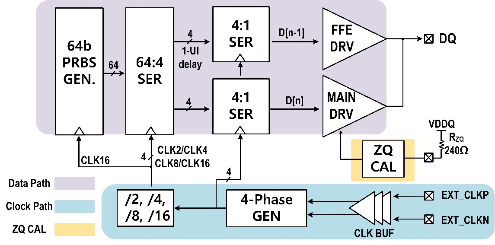
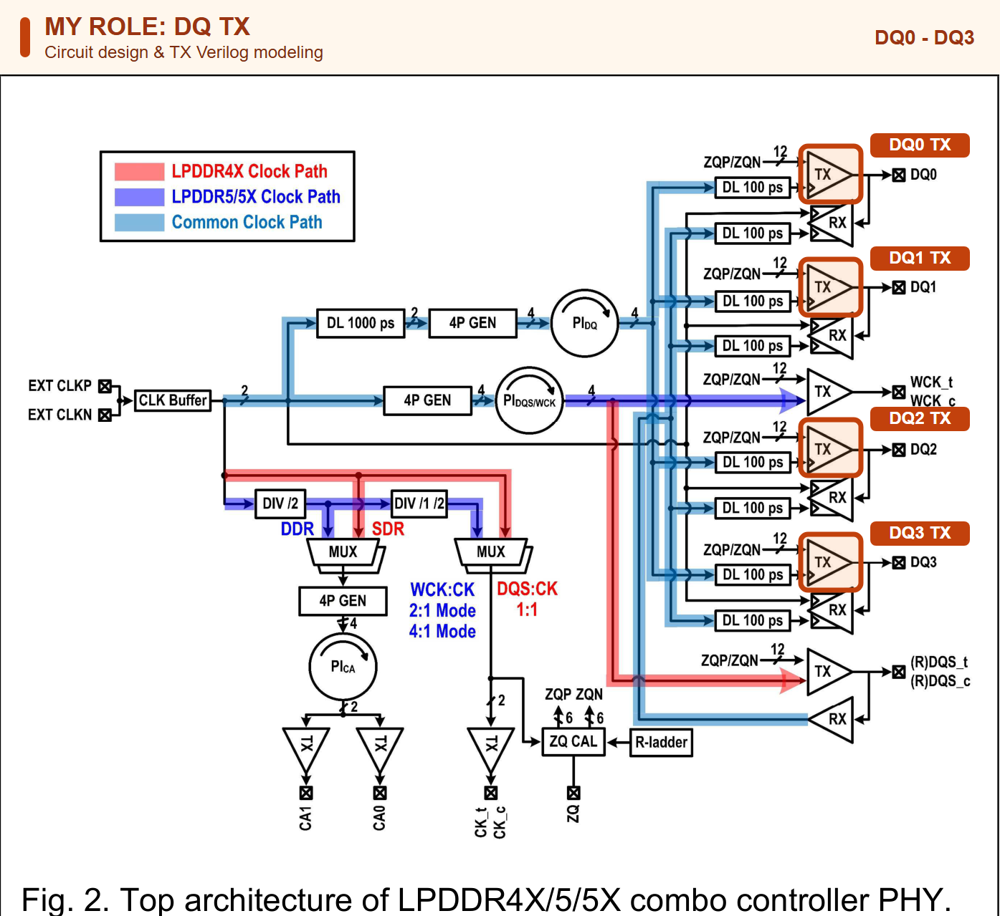
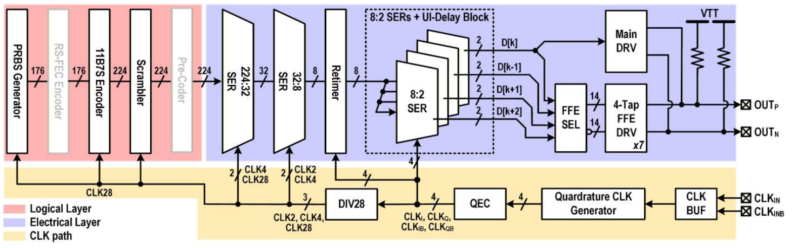

# [Juhyeong Yun](docs/profile.en.md#page-top) | High-Speed Interface & DSP Transceiver Research

Kwangwoon University · M.S. candidate · **Expected Feb 2027**

I research **high-speed interfaces** based on JEDEC [LPDDR](projects/high-speed-interface-research/docs/lpddr.en.md#page-top) and [USB4 Gen4](projects/high-speed-interface-research/docs/usb4-pam3.en.md#page-top) specifications, and **[DSP-based transceivers](docs/README.en.md#dsp-research)** for ultra-high-speed communication.

## Key results

- **[DSP / FPGA](#dsp-research): 8-Gb/s PAM4** physical-channel validation; **[35.7% fewer detector LUTs](projects/zcu208-pam4-dsp-portfolio/docs/validation.en.md#detector-resources)** than RS-ACS
- **[LPDDR](#interface-research): 15.6-Gb/s TX design**; 14-Gb/s/pin Combo PHY measurement participation
- **[USB&nbsp;PAM&#8209;3](#usb-research): TX RTL / RX CTLE models**; 32-Gb/s TX chip measurement participation

In line with current design trends, I use [AI](docs/ai-assisted-dsp-workflow.en.md#page-top) to assist with RTL, testbenches and automation code for repeatable verification and measurements.

## DSP transceiver research

### [A-SSCC 2026 | DS-SBM-based PAM4 transceiver DSP](projects/zcu208-pam4-dsp-portfolio/README.en.md#page-top)

<blockquote>
<strong>8-Gb/s PAM4 physical-channel validation · <a href="projects/zcu208-pam4-dsp-portfolio/docs/validation.en.md#detector-resources">35.7% fewer detector LUTs</a></strong> 
LUT comparison: detector only, relative to RS-ACS. 
<strong>My role:</strong> TX/RX filter and DS-SBM detector RTL, RFSoC integration, control and board validation. 
A-SSCC 2026 · <strong>First author · Accepted</strong>
</blockquote>

[Results](projects/zcu208-pam4-dsp-portfolio/README.en.md#asscc-result) · [Architecture](projects/zcu208-pam4-dsp-portfolio/docs/architecture.en.md#page-top) · [Vitis bring-up](projects/zcu208-pam4-dsp-portfolio/docs/vitis-bringup.en.md#page-top) · [Paper](https://epapers2.org/asscc2026/ESR/paper_details.php?paper_id=1351)

Measurement conditions and BER

4&nbsp;GS/s; estimated total path loss of about 41&nbsp;dB at 2&nbsp;GHz. At the selected PR responses: **PRBS7 BER < 10⁻⁷**, **PRBS15 BER < 2×10⁻⁶**. Detector FFs decrease by **22.5%** relative to RS-ACS. [Measurements and resources](projects/zcu208-pam4-dsp-portfolio/docs/validation.en.md#page-top)

My [master’s thesis](https://github.com/yunjuhyeong0916-glitch/pam4-mlsd-research/blob/main/projects/pam4-mlsd-thesis/README.en.md#page-top) develops the **DS-SBM architecture and RFSoC validation from A-SSCC; the manuscript is being finalized**. The [DP-SMM journal project](https://github.com/yunjuhyeong0916-glitch/pam4-mlsd-research/blob/main/projects/dp-smm-journal/README.en.md#page-top) is **follow-up work in progress**, extending the design to retain two paths per matrix entry.

[AI, MATLAB MCP and measurement automation](docs/ai-assisted-dsp-workflow.en.md#page-top) · [MLSD worked example](docs/concepts/mlsd.en.md#page-top)

## LPDDR / USB interface research

### [LPDDR 15.6&nbsp;Gb/s | Low-voltage TX circuit design](projects/high-speed-interface-research/docs/lpddr-tx-circuit-verification.en.md#page-top)

#### TX top architecture

The TX serializes 64-bit PRBS data and drives the output through main and one-UI-delayed paths. [Architecture and verification](projects/high-speed-interface-research/docs/lpddr-tx-circuit-verification.en.md#lpddr-tx-top-architecture)

<table width="715">
<thead><tr><th align="center">FFE OFF</th><th align="center">FFE ON</th></tr></thead>
<tbody><tr>
<td align="center"></td>
<td align="center"></td>
</tr></tbody>
</table>

<blockquote>
<strong>15.6&nbsp;Gb/s · Eye width 37 → 45.4&nbsp;ps · Height 56.5 → 75.1&nbsp;mV</strong> 
<strong>My role:</strong> 28-nm TX circuit design and schematic/post-layout verification. 
Circuit simulation · 8.7-dB channel loss · ICEIC 2025 <strong>Co-first author</strong>
</blockquote>

[Circuit and results](projects/high-speed-interface-research/docs/lpddr-tx-circuit-verification.en.md#page-top) · [FFE off/on comparison](projects/high-speed-interface-research/docs/lpddr-tx-circuit-verification.en.md#ffe-comparison) · [Paper](https://doi.org/10.1109/ICEIC64972.2025.10879746)

---

### [LPDDR Combo | TX design, modeling and 28-nm silicon evaluation](projects/high-speed-interface-research/docs/lpddr-combo.en.md#page-top)

#### Top architecture

The PHY shares clock and phase-alignment resources across LPDDR4X/5/5X modes. The orange DQ0–DQ3 TX blocks mark my circuit-design and TX Verilog-modeling contribution. [Architecture details](projects/high-speed-interface-research/docs/lpddr-combo.en.md#combo-top-architecture)

<table width="715">
<thead><tr><th align="center" width="50%">TX Eye</th><th align="center" width="50%">RX Shmoo</th></tr></thead>
<tbody><tr>
<td align="center" valign="top"></td>
<td align="center" valign="top"></td>
</tr></tbody>
</table>

<blockquote>
<strong>14&nbsp;Gb/s/pin · Four DQs active · TX eye 0.41&nbsp;UI / 65.3&nbsp;mV</strong> 
<strong>My role:</strong> TX circuit/model design, measurement PCB design and HFSS analysis; participation in chip measurements. 
28-nm silicon measurements · A-SSCC 2026 <strong>Co-author · Accepted</strong>
</blockquote>

[TX model and measurements](projects/high-speed-interface-research/docs/lpddr-combo.en.md#lpddr-combo-result) · [PCB/HFSS](projects/high-speed-interface-research/docs/lpddr-combo.en.md#si-pi-board-design) · [Paper](https://epapers2.org/asscc2026/ESR/paper_details.php?paper_id=1141)

---

### [USB&nbsp;PAM&#8209;3 | TX/RX modeling and TX silicon evaluation](projects/high-speed-interface-research/docs/usb4-pam3.en.md#page-top)

#### TX top architecture

The TX connects 11B7S encoding and scrambling to serialization and a four-tap FFE driver. [Architecture and contribution](projects/high-speed-interface-research/docs/usb4-pam3.en.md#usb-tx-top-architecture)

<blockquote>
<strong>32&nbsp;Gb/s · Eye height with FFE: upper 21.16&nbsp;mV / lower 19.80&nbsp;mV</strong> 
<strong>My role:</strong> TX RTL, RX CTLE modeling and integrated verification; participation in differential TX silicon measurements. 
IEEE TVLSI 2026 <strong>Co-first author</strong>
</blockquote>

[Measurements and FFE](projects/high-speed-interface-research/docs/pam3-differential-measurement.en.md#pam3-ffe-result) · [TX model](projects/high-speed-interface-research/docs/usb-tx-modeling.en.md#page-top) · [RX CTLE](projects/high-speed-interface-research/docs/usb-rx-ctle-modeling.en.md#page-top) · [Paper](https://doi.org/10.1109/TVLSI.2026.3701343)

Measurement conditions

CH3: 17.3-dB loss at 10.24&nbsp;GHz · PRBS15 · scrambler on. Upper and lower eyes are compared with FFE off/on on the same channel. [Setup and comparison](projects/high-speed-interface-research/docs/pam3-differential-measurement.en.md#page-top)

## Measurement / verification

### FPGA measurement and validation

[RFSoC board measurements](projects/zcu208-pam4-dsp-portfolio/docs/validation.en.md#board-measurements) · [Vivado resources and timing](projects/zcu208-pam4-dsp-portfolio/docs/validation.en.md#fpga-resources-and-timing) · [Vitis setup and control](projects/zcu208-pam4-dsp-portfolio/docs/vitis-bringup.en.md#page-top)

FPGA measurements, board control and automation

- **[RFSoC board measurements](projects/zcu208-pam4-dsp-portfolio/docs/validation.en.md#board-measurements):** Captured signals through the ZCU208 DAC → ISI board → ADC path and evaluated BER using PL PRBS checker counts.

- **[FPGA implementation · Vivado](projects/zcu208-pam4-dsp-portfolio/docs/validation.en.md#fpga-resources-and-timing):** Checked resource utilization and timing margin after RTL implementation.

- **[Board setup and control · Vitis](projects/zcu208-pam4-dsp-portfolio/docs/vitis-bringup.en.md#page-top):** Configured JTAG launch, clock and RFDC initialization, RX coefficient updates and data collection.

- **[Measurement automation](docs/ai-assisted-dsp-workflow.en.md#zcu208-measurement-harness):** Connected condition-specific app builds and execution with UART logging, then calculated BER from ILA counts in Python.

### 28-nm chip measurements / PCB and HFSS analysis

[PCB/HFSS](projects/high-speed-interface-research/docs/pcb-hfss-verification.en.md#page-top) · [LPDDR Eye and Shmoo](projects/high-speed-interface-research/docs/lpddr-combo.en.md#lpddr-combo-result) · [USB differential measurements](projects/high-speed-interface-research/docs/pam3-differential-measurement.en.md#page-top) · [Equipment and automation](projects/high-speed-interface-research/docs/measurement-equipment.en.md#page-top)

Chip measurements, PCB analysis and instrument automation

- **[PCB design and HFSS analysis](projects/high-speed-interface-research/docs/pcb-hfss-verification.en.md#page-top):** Analyzed transmission characteristics of the LPDDR measurement PCB and reviewed USB TX ground and power paths.

- **28-nm chip measurements:** Measured [LPDDR TX eyes and RX Shmoo](projects/high-speed-interface-research/docs/lpddr-combo.en.md#lpddr-combo-result) and compared [USB differential PAM&#8209;3 upper and lower eyes before and after FFE](projects/high-speed-interface-research/docs/pam3-differential-measurement.en.md#page-top).

- **[Instrument automation](projects/high-speed-interface-research/docs/measurement-equipment.en.md#page-top):** Coordinated power-supply, BERT and I2C control for voltage and timing sweeps. Applied early error stops and boundary searches, and logged results to CSV.

## Research publications

**1 first-author · 4 co-first-author · 1 co-author papers** · [Full publication list](docs/publications.en.md#page-top)

Six papers, author roles and presentation status

### DSP-based transceivers

- **A-SSCC 2026 · First author · Accepted:** [DS-SBM RFSoC PAM4 transceiver](https://epapers2.org/asscc2026/ESR/paper_details.php?paper_id=1351)

### LPDDR interfaces

- **A-SSCC 2026 · Co-author · Accepted:** [LPDDR4X/5/5X Combo PHY](https://epapers2.org/asscc2026/ESR/paper_details.php?paper_id=1141)
- **ICEIC 2025 · Co-first author:** [15.6-Gb/s low-voltage NRZ TX](https://doi.org/10.1109/ICEIC64972.2025.10879746)

### USB interfaces

- **IEEE TVLSI 2026 · Co-first author:** [PAM&#8209;3 TX with 150-preset four-tap FFE](https://doi.org/10.1109/TVLSI.2026.3701343)
- **SMACD 2025 · Co-first author:** [USB4 Gen4 PAM&#8209;3 TX model](https://doi.org/10.1109/SMACD65553.2025.11092283)
- **SMACD 2025 · Co-first author:** [PAM&#8209;3 RX model](https://doi.org/10.1109/SMACD65553.2025.11092233)

Both A-SSCC 2026 papers are accepted, with presentations forthcoming as of 2026-10-07. [Full publication list](docs/publications.en.md#page-top)

---

[Research CV](docs/profile.en.md#page-top) · [Term guide](docs/glossary.en.md#page-top) · [Repository map](docs/README.en.md#documentation-map) · [Verification status](docs/README.en.md#validation-status)

<!-- page-navigation:bottom -->

  

<!-- /page-navigation:bottom -->
