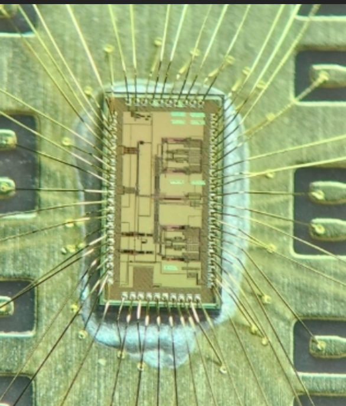
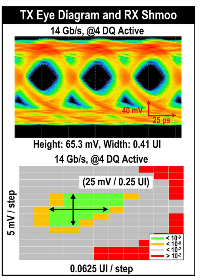
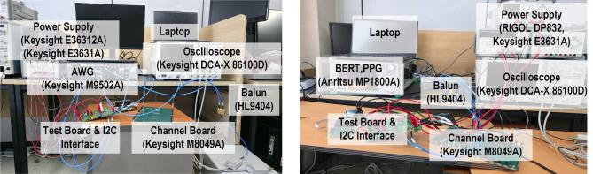

# [Juhyeong Yun](docs/profile.en.md) | High-Speed Interface & DSP Transceiver Research

Kwangwoon University · Master's thesis research in progress

I'm Juhyeong Yun. My research covers **high-speed interfaces based on JEDEC [LPDDR](projects/high-speed-interface-research/docs/lpddr.md) and [USB4 Gen4](projects/high-speed-interface-research/docs/usb4-pam3.md) specifications** and **[DSP-based transceivers](projects/README.md#dsp-transceiver-research) for ultra-high-speed communication**.

I design circuits and systems that compensate for channel loss and [ISI](docs/concepts/equalization.en.md#term-isi) to support reliable data transmission at high speeds.

In line with current design trends, I use [AI](docs/ai-assisted-dsp-workflow.en.md) to assist with RTL, testbench and automation code for repeatable verification and measurements.

## DSP transceiver research

### [A-SSCC 2026 | DS-SBM-based PAM4 transceiver DSP](projects/zcu208-pam4-dsp-portfolio/)

The ZCU208 DAC sends a signal through an ISI board to the ADC, evaluating the implemented receiver DSP and detector.

<blockquote>
<strong>41-dB channel · PRBS7 BER &lt; 10⁻⁷ · PRBS15 BER &lt; 2×10⁻⁶</strong> 
<strong>My role:</strong> PAM4 TX/RX filter and MLSD detector RTL, RFSoC integration, control and board validation. 
Results reported in A-SSCC 2026 · <strong>First author · Accepted</strong>
</blockquote>

[Measurement and implementation results](projects/zcu208-pam4-dsp-portfolio/README.md#asscc-result) · [Architecture](projects/zcu208-pam4-dsp-portfolio/docs/architecture.md) · [MLSD example](docs/concepts/mlsd.en.md) · [Paper](https://epapers2.org/asscc2026/ESR/paper_details.php?paper_id=1351)

My [**DS-SBM thesis**](https://github.com/yunjuhyeong0916-glitch/pam4-mlsd-research/blob/main/projects/pam4-mlsd-thesis/README.en.md) is being finalized. The follow-up [**DP-SMM journal research**](https://github.com/yunjuhyeong0916-glitch/pam4-mlsd-research/blob/main/projects/dp-smm-journal/README.md) is documented in a separate project.

<strong>View research · A-SSCC / AI assistance</strong>

### FPGA implementation and board control

I integrated **[32-lane PAM4 DSP](projects/zcu208-pam4-dsp-portfolio/docs/architecture.md)**, TX FIR, RX [21-tap FIR](docs/concepts/equalization.en.md#term-fir-taps) and [DS-SBM RS-MLSD](docs/concepts/mlsd.en.md) with the ZCU208 RFSoC. The [Vivado / Vitis flow](projects/zcu208-pam4-dsp-portfolio/docs/vitis-bringup.md) covers JTAG programming, CLK104 / RFDC initialization and coefficient updates. Measurement signals pass from the DAC through an [ISI board](projects/zcu208-pam4-dsp-portfolio/docs/validation.md#isi-보드를-통한-rfsoc-측정) to ADC capture.

[A-SSCC project](projects/zcu208-pam4-dsp-portfolio/) · [Design decisions](projects/zcu208-pam4-dsp-portfolio/docs/design-decisions.md) · [Vitis / FPGA bring-up](projects/zcu208-pam4-dsp-portfolio/docs/vitis-bringup.md) · [Measurement and implementation results](projects/zcu208-pam4-dsp-portfolio/docs/validation.md)

### AI assistance | RTL and measurement automation with MATLAB MCP

I used AI to help develop RTL and testbenches, plus automation code connecting ZCU208 coefficient settings, data collection and BER analysis.

[Toolbox roles and automation harness diagrams](docs/ai-assisted-dsp-workflow.en.md)

## LPDDR / USB interface research

### [LPDDR 15.6&nbsp;Gb/s | Low-voltage TX circuit design](projects/high-speed-interface-research/docs/lpddr-tx-circuit-verification.md)

**Circuit-simulation eyes:** FFE off on the left, FFE on on the right, compared at the same data rate.

<blockquote>
<strong>15.6&nbsp;Gb/s · Eye width 37 → 45.4&nbsp;ps · Height 56.5 → 75.1&nbsp;mV</strong> 
<strong>My role:</strong> 28-nm TX circuit design and schematic/post-layout verification. 
Circuit simulation · 8.7-dB channel loss · ICEIC 2025 <strong>Co-first author</strong>
</blockquote>

[Circuit and verification results](projects/high-speed-interface-research/docs/lpddr-tx-circuit-verification.md) · [FFE principles](docs/concepts/equalization.en.md#term-ffe) · [Paper](https://doi.org/10.1109/ICEIC64972.2025.10879746)

---

### [LPDDR Combo | TX design, modeling and 28-nm silicon evaluation](projects/high-speed-interface-research/docs/lpddr-combo.md)

COB assembly and wire bonds on the left; **measured TX eye and RX Shmoo at 14&nbsp;Gb/s/pin with four DQs active** on the right.

<blockquote>
<strong>14&nbsp;Gb/s/pin · TX eye 0.41&nbsp;UI / 65.3&nbsp;mV</strong> 
<strong>My role:</strong> TX circuit/model design, measurement PCB design and HFSS analysis; participation in chip measurements. 
28-nm silicon measurements · A-SSCC 2026 <strong>Co-author · Accepted</strong>
</blockquote>

[TX model and measurement results](projects/high-speed-interface-research/docs/lpddr-combo.md#lpddr-combo-result) · [PCB/HFSS](projects/high-speed-interface-research/docs/lpddr-combo-si-pi.md) · [Reading Eye and Shmoo](docs/concepts/measurements.en.md) · [Paper](https://epapers2.org/asscc2026/ESR/paper_details.php?paper_id=1141)

---

### [USB&nbsp;PAM&#8209;3 | TX/RX modeling and TX silicon evaluation](projects/high-speed-interface-research/docs/usb4-pam3.md)

Lab setups connect the TX board, channel and instruments. The eyes below compare FFE off and on on the same channel.

<blockquote>
<strong>32&nbsp;Gb/s · Eye height with FFE: upper 21.16&nbsp;mV / lower 19.80&nbsp;mV</strong> 
CH3: 17.3-dB loss at 10.24&nbsp;GHz · PRBS15 · scrambler on 
<strong>My role:</strong> TX RTL, RX CTLE modeling and integrated verification; participation in differential TX silicon measurements. 
IEEE TVLSI 2026 <strong>Co-first author</strong>
</blockquote>

[Measurements and FFE settings](projects/high-speed-interface-research/docs/pam3-differential-measurement.md#pam3-ffe-result) · [TX models](projects/high-speed-interface-research/docs/usb-tx-modeling.md) · [RX CTLE](projects/high-speed-interface-research/docs/usb-rx-ctle-modeling.md) · [Paper](https://doi.org/10.1109/TVLSI.2026.3701343)

<strong>View design and verification · TX / RX / PCB / HFSS / Measurements</strong>

| Research | Design and verification work | Key results |
|---|---|---|
| [LPDDR](projects/high-speed-interface-research/docs/lpddr.md) | [TX circuits](projects/high-speed-interface-research/docs/lpddr-tx-circuit-verification.md), [TX Verilog models](projects/high-speed-interface-research/docs/lpddr-tx-modeling.md), [PCB / HFSS](projects/high-speed-interface-research/docs/pcb-hfss-verification.md) | 15.6-Gb/s TX circuit simulation; participation in 14-Gb/s/pin Combo PHY measurements |
| [USB&nbsp;PAM&#8209;3](projects/high-speed-interface-research/docs/usb4-pam3.md) | [TX models / RTL](projects/high-speed-interface-research/docs/usb-tx-modeling.md), [RX CTLE models](projects/high-speed-interface-research/docs/usb-rx-ctle-modeling.md), [Differential PAM-3 measurements / FFE](projects/high-speed-interface-research/docs/pam3-differential-measurement.md) | Integrated TX/RX model verification; differential signal evaluation and FFE-effect checks on a 32-Gb/s TX chip |

[PCB / HFSS](projects/high-speed-interface-research/docs/pcb-hfss-verification.md) · [LPDDR / USB interface research](projects/high-speed-interface-research/)

## Measurement / verification

### FPGA measurement and validation

- **[RFSoC measurements](projects/zcu208-pam4-dsp-portfolio/docs/validation.md#isi-보드를-통한-rfsoc-측정):** Captured signals through the ZCU208 DAC → ISI board → ADC path and evaluated BER using PL PRBS checker counts.

- **[FPGA implementation · Vivado](projects/zcu208-pam4-dsp-portfolio/docs/validation.md#fpga-자원타이밍):** Checked resource utilization and timing margin after RTL implementation.

- **[Board setup and control · Vitis](projects/zcu208-pam4-dsp-portfolio/docs/vitis-bringup.md):** Configured JTAG launch, clock and RFDC initialization, RX coefficient updates and data collection.

- **[Measurement automation](docs/ai-assisted-dsp-workflow.en.md#zcu208-measurement-harness):** Connected condition-specific app builds and execution with UART logging, then calculated BER from ILA counts in Python.

### 28-nm chip measurements / PCB and HFSS analysis

- **[PCB design and HFSS analysis](projects/high-speed-interface-research/docs/pcb-hfss-verification.md):** Analyzed transmission characteristics of the LPDDR measurement PCB and reviewed USB TX ground and power paths.

- **28-nm chip measurements:** Measured [LPDDR TX eyes and RX Shmoo](projects/high-speed-interface-research/docs/verification-figures.md) and compared [USB differential PAM&#8209;3 upper and lower eyes before and after FFE](projects/high-speed-interface-research/docs/pam3-differential-measurement.md).

- **[Instrument automation](projects/high-speed-interface-research/docs/measurement-equipment.md):** Coordinated power-supply, BERT and I2C control for voltage and timing sweeps. Applied early error stops and boundary searches, and logged results to CSV.

## Research publications

### DSP-based transceivers

- **A-SSCC 2026 · First author · Accepted:** [DS-SBM RFSoC PAM4 transceiver](https://epapers2.org/asscc2026/ESR/paper_details.php?paper_id=1351)

### LPDDR interfaces

- **A-SSCC 2026 · Co-author · Accepted:** [LPDDR4X/5/5X Combo PHY](https://epapers2.org/asscc2026/ESR/paper_details.php?paper_id=1141)
- **ICEIC 2025 · Co-first author:** [15.6-Gb/s low-voltage NRZ TX](https://doi.org/10.1109/ICEIC64972.2025.10879746)

### USB interfaces

- **IEEE TVLSI 2026 · Co-first author:** [PAM&#8209;3 TX with 150-preset four-tap FFE](https://doi.org/10.1109/TVLSI.2026.3701343)
- **SMACD 2025 · Co-first author:** [USB4 Gen4 PAM&#8209;3 TX model](https://doi.org/10.1109/SMACD65553.2025.11092283)
- **SMACD 2025 · Co-first author:** [PAM&#8209;3 RX model](https://doi.org/10.1109/SMACD65553.2025.11092233)

Both A-SSCC 2026 papers are accepted, with presentations forthcoming as of 2026-10-07. [Full publication list](docs/publications.md)

---

[Repository map](docs/repository-map.md) · [Verification status](docs/validation-status.md) · [Term guide](docs/glossary.en.md)

<!-- page-navigation:bottom -->

  

<!-- /page-navigation:bottom -->
