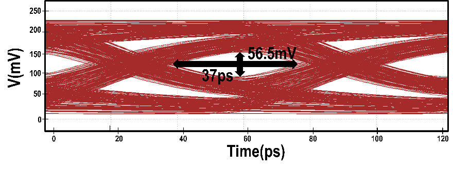
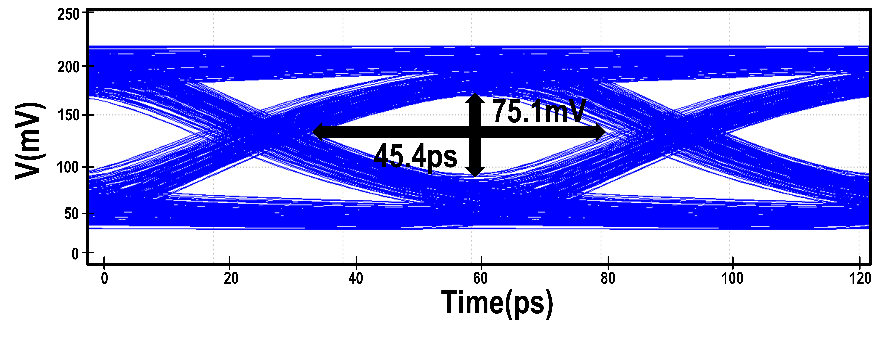
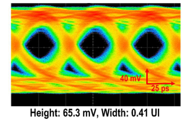
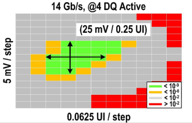
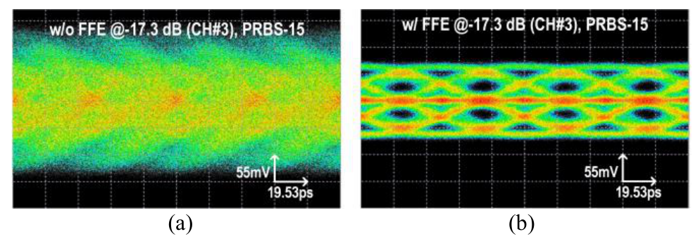

# [윤주형](docs/profile.md) | High-Speed Interface·DSP Transceiver 연구

광운대학교 · 전자통신공학 석사 · **2027.02&nbsp;졸&#8288;업&nbsp;예&#8288;정**

안녕하세요. 윤주형입니다. JEDEC [LPDDR](projects/high-speed-interface-research/docs/lpddr.md)·[USB4 Gen4](projects/high-speed-interface-research/docs/usb4-pam3.md) 규격 기반의 **High-Speed Interface**와 Ultra High-Speed 통신을 위한 <strong><a href="projects/README.md#dsp-transceiver-research">DSP 기반 Transceiver</a></strong>를 연구합니다.

## 대표 성과

- **[DSP·FPGA](#dsp-research): PAM4 8&nbsp;Gb/s** 물리채널 검증, RS-ACS 대비 검출기 **LUT 35.7% 감소**
- **[LPDDR](#interface-research): 15.6&nbsp;Gb/s TX 회로 설계**, 14&nbsp;Gb/s/pin Combo PHY 칩 측정 참여
- **[USB&nbsp;PAM&#8209;3](#usb-research): TX RTL·RX CTLE 모델링**, 32&nbsp;Gb/s TX 칩 측정 참여

최근 설계 트렌드에 맞게 [AI](docs/ai-assisted-dsp-workflow.md)를 RTL·테스트벤치 작성과 반복 검증·측정 자동화 코드 구성에 활용합니다.

## DSP 기반 송수신기 연구

### [A-SSCC 2026 | DS-SBM 기반 PAM4 송수신 DSP](projects/zcu208-pam4-dsp-portfolio/)

<blockquote>
<strong>PAM4 8&nbsp;Gb/s 물리채널 검증 · 검출기 LUT 35.7% 감소</strong> 
LUT 감소율: RS-ACS 대비, 검출기 단독 집계. 
<strong>담당:</strong> TX·RX 필터와 DS-SBM 검출기 RTL 설계, RFSoC 통합·제어·보드 검증. 
A-SSCC 2026 · <strong>제1저자 · 채택</strong>
</blockquote>

[측정·구현 결과](projects/zcu208-pam4-dsp-portfolio/README.md#asscc-result) · [설계 구조](projects/zcu208-pam4-dsp-portfolio/docs/architecture.md) · [Vitis 구동](projects/zcu208-pam4-dsp-portfolio/docs/vitis-bringup.md) · [논문](https://epapers2.org/asscc2026/ESR/paper_details.php?paper_id=1351)

측정 조건·BER 보기

4&nbsp;GS/s, 2&nbsp;GHz에서 추정 전체 경로 손실 약 41&nbsp;dB. 선정 PR 응답 조건의 BER은 **PRBS7 < 10⁻⁷**, **PRBS15 < 2×10⁻⁶**입니다. 검출기 FF는 RS-ACS 대비 **22.5% 감소**했습니다. [측정·자원 결과](projects/zcu208-pam4-dsp-portfolio/docs/validation.md)

[학위논문](https://github.com/yunjuhyeong0916-glitch/pam4-mlsd-research/blob/main/projects/pam4-mlsd-thesis/README.md)은 A-SSCC의 DS-SBM 구조·RFSoC 검증을 상세히 정리한 연구로, <strong>원고 마무리 중</strong>입니다. [Journal의 DP-SMM](https://github.com/yunjuhyeong0916-glitch/pam4-mlsd-research/blob/main/projects/dp-smm-journal/README.md)은 행렬 원소에 두 경로를 보존하도록 확장한 <strong>후속 연구 (진행 중)</strong>입니다.

[AI 활용·MATLAB MCP·측정 자동화 harness](docs/ai-assisted-dsp-workflow.md) · [MLSD를 예제로 이해하기](docs/concepts/mlsd.md)

## LPDDR·USB 인터페이스 연구

### [LPDDR 15.6&nbsp;Gb/s | 저전압 TX 설계](projects/high-speed-interface-research/docs/lpddr-tx-circuit-verification.md)

<table>
<thead><tr><th align="center">FFE OFF</th><th align="center">FFE ON</th></tr></thead>
<tbody><tr>
<td align="center"></td>
<td align="center"></td>
</tr></tbody>
</table>

<blockquote>
<strong>15.6&nbsp;Gb/s · Eye 폭 37 → 45.4&nbsp;ps · 높이 56.5 → 75.1&nbsp;mV</strong> 
<strong>담당:</strong> 28&nbsp;nm TX 회로 설계와 Schematic·Post-Layout 검증. 
회로 시뮬레이션 · 채널 손실 8.7&nbsp;dB · ICEIC 2025 <strong>공동 제1저자</strong>
</blockquote>

[회로 구조·검증 결과](projects/high-speed-interface-research/docs/lpddr-tx-circuit-verification.md) · [FFE 적용 전후 비교](projects/high-speed-interface-research/docs/lpddr-tx-circuit-verification.md#2-ffe-적용-전후의-eye로-보상-효과-확인) · [논문](https://doi.org/10.1109/ICEIC64972.2025.10879746)

---

### [LPDDR Combo | TX 설계·모델링과 28&nbsp;nm 칩 평가](projects/high-speed-interface-research/docs/lpddr-combo.md)

<table>
<thead><tr><th align="center" width="50%">TX Eye</th><th align="center" width="50%">RX Shmoo</th></tr></thead>
<tbody><tr>
<td align="center"></td>
<td align="center"></td>
</tr></tbody>
</table>

<blockquote>
<strong>14&nbsp;Gb/s/pin · TX Eye 0.41&nbsp;UI / 65.3&nbsp;mV</strong> 
<strong>담당:</strong> DQ TX 회로·Verilog 모델, 측정용 PCB 설계·HFSS 분석. 칩 측정 참여. 
28&nbsp;nm 제작 칩 측정 · A-SSCC 2026 <strong>공&#8288;동&#8288;저&#8288;자 · 채택</strong>
</blockquote>

[TX 모델·측정 결과](projects/high-speed-interface-research/docs/lpddr-combo.md#lpddr-combo-result) · [PCB·HFSS](projects/high-speed-interface-research/docs/lpddr-combo-si-pi.md) · [논문](https://epapers2.org/asscc2026/ESR/paper_details.php?paper_id=1141)

---

### [USB&nbsp;PAM&#8209;3 | TX·RX 모델링과 TX 칩 평가](projects/high-speed-interface-research/docs/usb4-pam3.md)

<blockquote>
<strong>32&nbsp;Gb/s · FFE 적용 후 Eye 높이: 상단 21.16&nbsp;mV / 하단 19.80&nbsp;mV</strong> 
<strong>담당:</strong> TX RTL·RX CTLE 모델링과 통합 검증, TX 칩의 차동 신호 측정 참여. 
IEEE TVLSI 2026 <strong>공동 제1저자</strong>
</blockquote>

[측정 결과·FFE 설정](projects/high-speed-interface-research/docs/pam3-differential-measurement.md#pam3-ffe-result) · [TX 모델](projects/high-speed-interface-research/docs/usb-tx-modeling.md) · [RX CTLE](projects/high-speed-interface-research/docs/usb-rx-ctle-modeling.md) · [논문](https://doi.org/10.1109/TVLSI.2026.3701343)

측정 조건 보기

CH#3 손실 17.3&nbsp;dB @ 10.24&nbsp;GHz · PRBS15 · scrambler on. 같은 채널에서 FFE off/on의 상·하단 Eye를 비교했습니다. [측정 구성·조건별 비교](projects/high-speed-interface-research/docs/pam3-differential-measurement.md)

## 측정·검증

### FPGA 측정·검증

[RFSoC 실측](projects/zcu208-pam4-dsp-portfolio/docs/validation.md#isi-보드를-통한-rfsoc-측정) · [Vivado 자원·타이밍](projects/zcu208-pam4-dsp-portfolio/docs/validation.md#fpga-자원타이밍) · [Vitis 초기화·제어](projects/zcu208-pam4-dsp-portfolio/docs/vitis-bringup.md)

FPGA 측정·구동·자동화 내용 보기

- **[RFSoC 실측](projects/zcu208-pam4-dsp-portfolio/docs/validation.md#isi-보드를-통한-rfsoc-측정):** ZCU208 DAC → ISI 보드 → ADC 경로의 신호를 캡처하고 PL PRBS 검사기 집계값으로 BER을 평가했습니다.

- **[FPGA 구현 · Vivado](projects/zcu208-pam4-dsp-portfolio/docs/validation.md#fpga-자원타이밍):** RTL 구현 결과의 자원 사용량과 타이밍 여유를 확인했습니다.

- **[보드 초기화·제어 · Vitis](projects/zcu208-pam4-dsp-portfolio/docs/vitis-bringup.md):** JTAG 실행, 클록·RFDC 초기화, RX 계수 적용과 데이터 수집을 구성했습니다.

- **[측정 자동화](docs/ai-assisted-dsp-workflow.md#zcu208-측정-harness):** 조건별 앱 빌드·실행과 UART 기록을 묶고, ILA 집계값을 Python으로 분석해 BER을 산출했습니다.

### 28 nm 칩 측정·PCB/HFSS 분석

[PCB·HFSS](projects/high-speed-interface-research/docs/pcb-hfss-verification.md) · [LPDDR Eye·Shmoo](projects/high-speed-interface-research/docs/verification-figures.md) · [USB 차동 측정](projects/high-speed-interface-research/docs/pam3-differential-measurement.md) · [장비·자동화](projects/high-speed-interface-research/docs/measurement-equipment.md)

칩 측정·PCB 분석·계측 자동화 내용 보기

- **[PCB·HFSS 설계·분석](projects/high-speed-interface-research/docs/pcb-hfss-verification.md):** LPDDR 측정용 PCB의 전달 특성을 분석하고, USB TX의 접지·전원 경로를 검토했습니다.

- **28 nm 칩 측정:** [LPDDR TX Eye·RX Shmoo](projects/high-speed-interface-research/docs/verification-figures.md)를 측정하고, [USB 차동 PAM&#8209;3의 FFE 적용 전후 상·하단 Eye](projects/high-speed-interface-research/docs/pam3-differential-measurement.md)를 비교했습니다.

- **[계측 자동화](projects/high-speed-interface-research/docs/measurement-equipment.md):** 전원·BERT·I2C를 연동해 전압·타이밍을 스윕하고, 오류 조기 종료·경계 탐색을 적용했습니다. 결과는 CSV로 기록했습니다.

## 연구 성과 논문

**제1저자 1편 · 공동 제1저자 4편 · 공동저자 1편** · [전체 논문 목록](docs/publications.md)

논문 6편·저자 역할·발표 상태 보기

### DSP 기반 송수신기

- **A-SSCC 2026 · 제1저자 · 채택:** [DS-SBM 기반 RFSoC PAM4 송수신기](https://epapers2.org/asscc2026/ESR/paper_details.php?paper_id=1351)

### LPDDR 인터페이스

- **A-SSCC 2026 · 공동저자 · 채택:** [LPDDR4X/5/5X Combo PHY](https://epapers2.org/asscc2026/ESR/paper_details.php?paper_id=1141)
- **ICEIC 2025 · 공동 제1저자:** [15.6-Gb/s 저전압 NRZ TX](https://doi.org/10.1109/ICEIC64972.2025.10879746)

### USB 인터페이스

- **IEEE TVLSI 2026 · 공동 제1저자:** [150-preset 4-tap FFE를 적용한 PAM&#8209;3 TX](https://doi.org/10.1109/TVLSI.2026.3701343)
- **SMACD 2025 · 공동 제1저자:** [USB4 Gen4 PAM&#8209;3 TX 모델](https://doi.org/10.1109/SMACD65553.2025.11092283)
- **SMACD 2025 · 공동 제1저자:** [PAM&#8209;3 RX 모델](https://doi.org/10.1109/SMACD65553.2025.11092233)

A-SSCC 2026 두 편: 채택·발표 예정(2026-10-07 기준). [전체 논문 목록](docs/publications.md)

---

[연구 이력](docs/profile.md) · [용어 안내](docs/glossary.md) · [문서 지도](docs/repository-map.md) · [검증 상태](docs/validation-status.md)

<!-- page-navigation:bottom -->

  

<!-- /page-navigation:bottom -->
