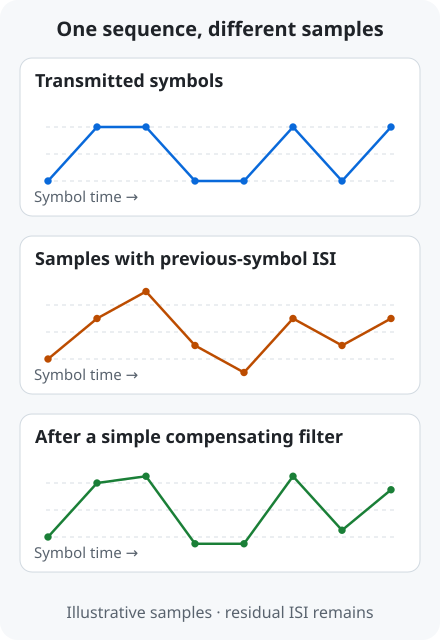

# ISI and equalization | Compensating for overlapping symbols

[← Term guide](../glossary.en.md#page-top) · [CV](../profile.en.md#page-top) · [Home](../../README.en.md#page-top)

**Equalization compensates for changes introduced by the transmission path so that a receiver can distinguish data more reliably.**

A **symbol** is one transmitted signal value. The **channel** is its path through traces, connectors or cables.

## 1. The same symbol can produce different observations

Assume the current symbol is `+1` and half of the previous symbol remains in the observation. A previous `+1` gives `1.5`; a previous `−1` gives `0.5`. **The current data is the same, but earlier data changes what the receiver sees.**

This illustration sends the same sequence through a channel and applies a simple compensating filter. Some residual influence remains. **ISI** (Inter-Symbol Interference) means that one symbol affects observations of other symbols. [Equalization principles](https://www.mathworks.com/help/comm/ug/equalization.html)

## 2. What information does each equalizer use?

**FFE** (Feed-Forward Equalizer) combines weighted signal values from several times. A TX FFE shapes the outgoing waveform; an RX FFE compensates the received signal. [FFE](https://www.mathworks.com/help/serdes/ref/serdes.ffe-system-object.html)

**CTLE** (Continuous-Time Linear Equalizer) adjusts analog gain with frequency. It can relatively boost high-frequency components attenuated by a channel. [CTLE](https://www.mathworks.com/help/serdes/ref/serdes.ctle-system-object.html)

**DFE** (Decision-Feedback Equalizer) uses earlier symbol decisions to estimate and subtract their contribution to the current observation. [DFE](https://www.mathworks.com/help/serdes/ref/serdes.dfe-system-object.html)

## 3. What does a 21-tap FFE mean?

An **FIR** (Finite Impulse Response) filter forms a weighted sum of samples from several times. A weight is a **coefficient**, and each sample contribution is a **tap**.

A `21-tap RX FFE` combines 21 sample positions, each multiplied by its coefficient. The project implements this operation in RTL. [RX FIR architecture](../../projects/zcu208-pam4-dsp-portfolio/docs/architecture.en.md#page-top)

Read more · Partial-response targets and MLSD

A **partial-response (PR) target** specifies how current and previous symbols should contribute to a detector observation. Equalization shapes the response, and MLSD uses that response to predict candidate observations.

The A-SSCC DS-SBM path is **RX FFE → three-tap PR FIR → MLSD**. [Implemented signal path](../../projects/zcu208-pam4-dsp-portfolio/docs/architecture.en.md#page-top)

## Continue to the research results

[USB TX FFE model results](../../projects/high-speed-interface-research/docs/usb-tx-modeling.en.md#usb-tx-ffe-result) · [USB RX CTLE input/output eyes](../../projects/high-speed-interface-research/docs/usb-rx-ctle-modeling.en.md#usb-rx-ctle-result) · [USB silicon FFE measurements](../../projects/high-speed-interface-research/docs/pam3-differential-measurement.en.md#pam3-ffe-result)

[← PAM signaling](pam-signaling.en.md#page-top) · [Using residual ISI with MLSD →](mlsd.en.md#page-top)

---

[← Term guide](../glossary.en.md#page-top) · [CV](../profile.en.md#page-top) · [Home](../../README.en.md#page-top) · [Back to top](#page-top)
