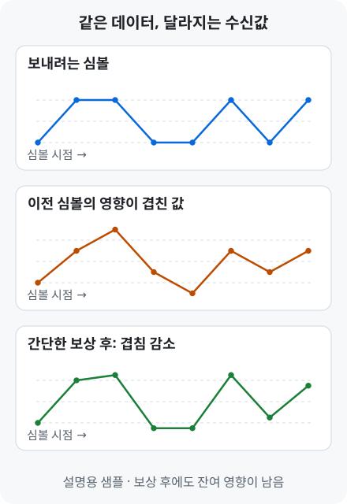

# ISI·등화 | 겹쳐 보이는 신호를 보상하는 방법

[← 용어 안내](../glossary.md) · [연구 이력](../profile.md) · [홈](../../README.md)

**등화는 전송 경로에서 변한 신호를 보상해, 수신기가 데이터를 구분하기 쉽게 만드는 과정입니다.**

한 번에 보내는 신호 값을 **심볼**, 신호가 지나가는 배선·커넥터·케이블 등을 **채널**이라고 합니다.

## 1. 같은 심볼도 앞선 데이터에 따라 다르게 보입니다

현재 심볼이 `+1`이고 이전 심볼의 절반이 수신값에 남는다고 가정하겠습니다. 이전 심볼이 `+1`이면 `1.5`, `−1`이면 `0.5`가 관측됩니다. **현재 데이터가 같아도 앞선 데이터 때문에 수신값이 달라지는 것**이 ISI의 한 예입니다.

위는 같은 심볼열을 보내고 이전 심볼 영향이 겹친 뒤, 간단한 필터로 보상한 설명용 예입니다. 보상 후에도 일부 영향은 남습니다. **ISI**(Inter-Symbol Interference)는 한 심볼이 다른 심볼의 관측 시점에 영향을 주는 현상입니다. [등화 원리](https://www.mathworks.com/help/comm/ug/equalization.html)

## 2. FFE·CTLE·DFE는 무엇을 이용해 보상하나요?

**FFE**(Feed-Forward Equalizer)는 여러 시점의 신호에 가중치를 곱해 합칩니다. TX FFE는 채널에 보내기 전 파형을 조정하고, RX FFE는 받은 신호를 보상합니다. [FFE](https://www.mathworks.com/help/serdes/ref/serdes.ffe-system-object.html)

**CTLE**(Continuous-Time Linear Equalizer)는 아날로그 신호의 주파수별 이득을 조정합니다. 채널에서 약해진 고주파 성분을 상대적으로 보강합니다. [CTLE](https://www.mathworks.com/help/serdes/ref/serdes.ctle-system-object.html)

**DFE**(Decision-Feedback Equalizer)는 이미 판정한 이전 심볼을 사용합니다. 이전 심볼이 현재 신호에 남길 영향을 계산해 빼 주는 방식입니다. [DFE](https://www.mathworks.com/help/serdes/ref/serdes.dfe-system-object.html)

## 3. 21-tap FFE는 무엇을 뜻하나요?

**FIR**(Finite Impulse Response)은 여러 시점의 샘플을 가중 합산하는 필터입니다. 각 샘플에 곱하는 가중치가 **계수**, 샘플별 계산 항이 **tap**입니다.

`21-tap RX FFE`는 21개 시점의 샘플에 각각 계수를 곱해 더하는 수신 등화 구조입니다. 이 연구에서는 이 연산을 RTL로 구현했습니다. [RX FIR 구조](../../projects/zcu208-pam4-dsp-portfolio/docs/architecture.md)

더 자세히 보기 · PR 목표와 MLSD의 연결

**PR**(Partial Response) 목표는 현재 수신값에 현재·이전 심볼이 각각 얼마나 반영되도록 할지 정한 응답입니다. 등화 출력을 이 응답에 가깝게 만들고, MLSD가 같은 응답으로 후보별 예상값을 계산합니다.

A-SSCC DS-SBM 경로는 **RX FFE → 3-tap PR FIR → MLSD**입니다. [실제 신호 경로](../../projects/zcu208-pam4-dsp-portfolio/docs/architecture.md)

## 실제 연구 결과로 이어서 보기

[USB TX FFE 모델 결과](../../projects/high-speed-interface-research/docs/usb-tx-modeling.md#usb-tx-ffe-result) · [USB RX CTLE 입출력 Eye](../../projects/high-speed-interface-research/docs/usb-rx-ctle-modeling.md#usb-rx-ctle-result) · [USB 칩의 FFE 측정 결과](../../projects/high-speed-interface-research/docs/pam3-differential-measurement.md#pam3-ffe-result)

[← PAM 신호 이해하기](pam-signaling.md) · [남은 ISI를 이용하는 MLSD →](mlsd.md)

---

[← 용어 안내](../glossary.md) · [연구 이력](../profile.md) · [홈](../../README.md) · [맨 위로](#page-top)
