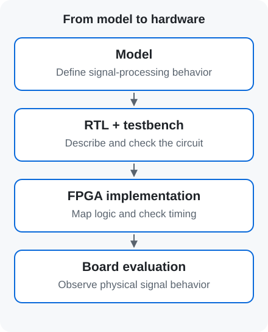

# DSP, RTL, FPGA and RFSoC | From algorithm to board evaluation

[← Term guide](../glossary.en.md) · [CV](../profile.en.md) · [Home](../../README.en.md)

**DSP describes signal-processing operations, RTL describes a digital circuit, and an FPGA implements that circuit in configurable hardware.** Connecting these stages makes it possible to evaluate an algorithm using physical signals.

## DSP: define the signal-processing operations

**DSP (Digital Signal Processing)** operates on sampled signals using digital arithmetic. The receiver here uses an [FFE](equalization.en.md#term-ffe) for compensation and [MLSD](mlsd.en.md) for sequence detection.

## RTL: describe arithmetic, storage and data movement

**RTL (Register-Transfer Level)** specifies values held in registers and the operations and transfers performed between clock events. Verilog and SystemVerilog describe the filter and detector datapaths and control. Parallel arithmetic and pipeline alignment are part of the circuit design. [Project RTL architecture](../../projects/zcu208-pam4-dsp-portfolio/docs/architecture.md)

## FPGA and RFSoC: implement the circuit

An **FPGA (Field-Programmable Gate Array)** provides configurable logic and connections. An **RFSoC** integrates processor resources, programmable logic and high-speed **ADCs and DACs**. A DAC converts digital samples to an analog signal; an ADC converts an analog signal to samples. [AMD Zynq UltraScale+ RFSoC](https://www.amd.com/en/products/adaptive-socs-and-fpgas/soc/zynq-ultrascale-plus-rfsoc.html)

## PS and PL: control software and signal-processing hardware

- **PS (Processing System):** runs control software. Here it initializes clocks and converters, applies coefficients and collects data.
- **PL (Programmable Logic):** runs the implemented RTL, including filters, detection and PRBS error counting.

**ZCU208** is the RFSoC evaluation board used in this research. [Board startup and control](../../projects/zcu208-pam4-dsp-portfolio/docs/vitis-bringup.md)

## Vivado, Vitis and ILA

Here, **Vivado** supports RTL simulation and FPGA implementation; **Vitis** builds and runs the PS control application. An **ILA (Integrated Logic Analyzer)** observes internal FPGA signals for debugging. [AMD embedded development flow](https://xilinx.github.io/Embedded-Design-Tutorials/docs/2022.2/build/html/docs/Introduction/ZynqMPSoC-EDT/4-build-sw-for-ps-subsystems.html)

## Reading verification and implementation results

A **testbench** supplies inputs and checks circuit behavior. Model and RTL outputs are compared, followed by resource and timing checks after implementation. **WNS** reports the worst slack, and **TNS** the sum of negative slack. Slack expresses margin against a timing requirement. [Project results](../../projects/zcu208-pam4-dsp-portfolio/docs/validation.md)

**32-lane** means the number of parallel data items processed in a clock cycle here. **II (Initiation Interval)** is the minimum clock interval between accepted input groups. Data width, clock rate and II together describe processing throughput. [Parallel datapath](../../projects/zcu208-pam4-dsp-portfolio/docs/architecture.md#병렬-데이터-경로)

## Related research

[A-SSCC FPGA project](../../projects/zcu208-pam4-dsp-portfolio/) · [Automation harness](../ai-assisted-dsp-workflow.en.md)

---

[← Term guide](../glossary.en.md) · [CV](../profile.en.md) · [Home](../../README.en.md) · [Back to top](#page-top)
