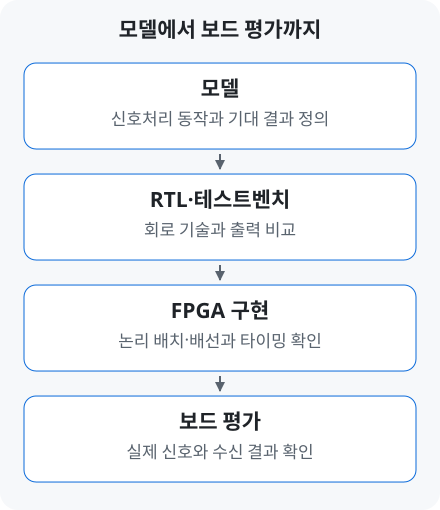

# DSP·RTL·FPGA·RFSoC | 알고리즘이 보드에서 동작하기까지

[← 용어 안내](../glossary.md#page-top) · [연구 이력](../profile.md#page-top) · [홈](https://github.com/yunjuhyeong0916-glitch/jhyun#page-top)

**DSP는 신호를 처리하는 방법, RTL은 디지털 회로를 기술하는 방식, FPGA는 그 회로를 구현하는 장치입니다.** 이 세 단계를 연결하면 모델에서 정한 동작을 실제 신호로 확인할 수 있습니다.

## DSP: 신호에 필요한 계산을 정합니다

**DSP**(Digital Signal Processing)는 샘플로 표현한 신호를 디지털 연산으로 처리하는 방식입니다. 이 연구에서는 신호를 보상하는 [FFE](equalization.md#term-ffe)와 데이터열을 찾는 [MLSD](mlsd.md#page-top)가 주요 수신 연산입니다.

## RTL: 연산과 저장이 회로에서 어떻게 연결되는지 적습니다

레지스터는 값을 저장하는 회로이고, 클록은 동작의 기준 박자입니다. **RTL**(Register-Transfer Level)에서는 레지스터에 무엇을 저장하고, 한 클록 동안 어떤 연산과 데이터 이동을 수행할지 기술합니다. Verilog·SystemVerilog를 사용해 필터·검출기의 데이터 경로와 제어를 작성합니다. 여러 연산을 병렬로 배치하고 지연을 맞추는 일이 구현의 일부입니다. [이 프로젝트의 RTL 구성](../../projects/zcu208-pam4-dsp-portfolio/docs/architecture.md#page-top)

## FPGA·RFSoC: 설계한 회로를 실제 장치에 구현합니다

**FPGA**(Field-Programmable Gate Array)는 내부 논리와 연결을 설정해 디지털 회로를 구현할 수 있는 장치입니다. **RFSoC**는 프로세서·FPGA 논리와 고속 **ADC·DAC**를 한 장치에 통합합니다. DAC는 디지털 샘플을 아날로그 신호로, ADC는 아날로그 신호를 디지털 샘플로 바꿉니다. [AMD Zynq UltraScale+ RFSoC](https://www.amd.com/en/products/adaptive-socs-and-fpgas/soc/zynq-ultrascale-plus-rfsoc.html)

## PS·PL: 제어 프로그램과 신호처리 회로의 역할

- **PS(Processing System):** 프로세서에서 제어 프로그램을 실행합니다. 이 프로젝트에서는 클록·변환기 초기화와 계수 설정·데이터 수집을 맡습니다.
- **PL(Programmable Logic):** RTL로 구현한 회로가 동작합니다. 필터·검출기와 PRBS 오류 집계를 수행합니다.

**ZCU208**은 이 연구에서 사용하는 RFSoC 평가 보드의 이름입니다. [보드 초기화·제어 흐름](../../projects/zcu208-pam4-dsp-portfolio/docs/vitis-bringup.md#page-top)

## Vivado·Vitis·ILA는 어디에 쓰이나요?

이 프로젝트에서 **Vivado**는 RTL 시뮬레이션·FPGA 회로 구현에, **Vitis**는 PS 제어 앱의 빌드·실행에 사용합니다. **ILA**(Integrated Logic Analyzer)는 FPGA 내부 신호를 관찰하는 디버깅 수단입니다. [AMD의 하드웨어·소프트웨어 개발 흐름](https://xilinx.github.io/Embedded-Design-Tutorials/docs/2022.2/build/html/docs/Introduction/ZynqMPSoC-EDT/4-build-sw-for-ps-subsystems.html)

## 모델과 회로의 결과를 비교합니다

**Testbench**는 회로에 입력을 주고 출력·동작을 점검하는 검증 코드입니다. 같은 입력에서 모델과 RTL의 결과를 비교하고, FPGA에 구현한 뒤에는 자원 사용량과 타이밍을 확인합니다. [실제 구현·검증 결과](../../projects/zcu208-pam4-dsp-portfolio/docs/validation.md#fpga-자원타이밍)

구현 지표 더 보기 · WNS·TNS

**Slack**은 정해진 타이밍 조건에 대한 여유입니다. **WNS**는 보고된 경로 중 가장 나쁜 slack, **TNS**는 음수 slack의 합입니다. 자원 사용량과 함께 구현 보고서에서 확인합니다.

병렬 처리 더 보기 · 32심볼 병렬 처리·II

<strong>32심볼 병렬 처리(32-lane)</strong>는 이 연구에서 한 클록에 32개 심볼을 묶어 처리하는 구조입니다. **II**(Initiation Interval)는 새 입력 묶음을 받아들일 수 있는 최소 클록 간격입니다. 데이터 폭·클록·II를 함께 보면 처리량을 이해할 수 있습니다. [병렬 데이터 경로](../../projects/zcu208-pam4-dsp-portfolio/docs/architecture.md#병렬-데이터-경로)

## 관련 연구

[A-SSCC FPGA 프로젝트](../../projects/zcu208-pam4-dsp-portfolio/README.md#page-top) · [자동화 harness의 연결 구조](../ai-assisted-dsp-workflow.md#page-top)

---

[← 용어 안내](../glossary.md#page-top) · [연구 이력](../profile.md#page-top) · [홈](https://github.com/yunjuhyeong0916-glitch/jhyun#page-top) · [맨 위로](#page-top)
