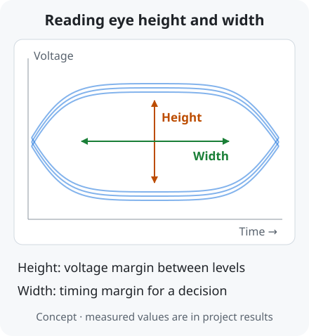
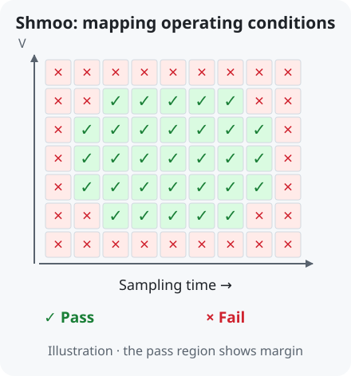

# Eye, BER and Shmoo | Reading measurement results

[← Term guide](../glossary.en.md#page-top) · [CV](../profile.en.md#page-top) · [Home](../../README.en.md#page-top)

**An eye diagram shows voltage and timing margins, BER is the fraction of compared bits detected incorrectly, and a Shmoo plot maps operation across test conditions.**

## 1. Eye: how much room is there for a decision?

Overlaying waveform segments aligned to symbol timing produces an **eye diagram**.

**Eye height** helps assess voltage margin between levels; **eye width** helps assess timing margin. [Eye-diagram principles](https://helpfiles.keysight.com/csg/N1930xB/Analyzing/Analyzing_Data_using_Eye_Diagrams.html)

[PAM-3](pam-signaling.en.md#term-pam3) has two eyes between its three levels. **Timing opening** is the timing range meeting a specified error criterion.

[Measured USB silicon eyes with FFE off/on →](../../projects/high-speed-interface-research/docs/pam3-differential-measurement.en.md#pam3-ffe-result)

## 2. BER: what fraction of compared bits were wrong?

**BER** (Bit Error Ratio) is `bit errors ÷ compared bits`. An illustrative count of ten errors in 1,000,000 bits gives `10 ÷ 1,000,000 = 10⁻⁵`. [BER definition](https://helpfiles.keysight.com/csg/89600B/Webhelp/Subsystems/flexframe/content/trc_carrier_summary.htm)

Sending a known bit pattern makes it possible to compare recovered data and count errors. A **PRBS** (Pseudo-Random Binary Sequence) is a pattern reproducible from the same generation rule.

The RFSoC work calculates BER from the internal checker's error count and compared-bit count. [RFSoC board measurements and BER →](../../projects/zcu208-pam4-dsp-portfolio/docs/validation.en.md#board-measurements)

An eye diagram shows waveform margins; BER evaluates the recovered data. Together they help relate waveform changes to receiver performance.

## 3. Shmoo: across which conditions does it work?

A Shmoo plot varies parameters such as voltage and sampling time and marks pass/fail for each combination. The extent of the pass region indicates operating margin. [Shmoo principles](https://www.ni.com/docs/en-US/bundle/ni-digital-pattern/page/shmoo-plot.html)

[Measured LPDDR Combo TX eye and RX Shmoo →](../../projects/high-speed-interface-research/docs/lpddr-combo.en.md#lpddr-combo-result)

Instruments · AWG, BERT and oscilloscope

- **AWG:** generates a specified waveform as receiver input.
- **BERT:** generates known bit patterns and/or compares received patterns to measure errors.
- **Oscilloscope:** observes voltage waveforms over time and eye diagrams.

[Instrument roles and measurement automation](../../projects/high-speed-interface-research/docs/measurement-equipment.en.md#page-top)

---

[← Term guide](../glossary.en.md#page-top) · [CV](../profile.en.md#page-top) · [Home](../../README.en.md#page-top) · [Back to top](#page-top)
