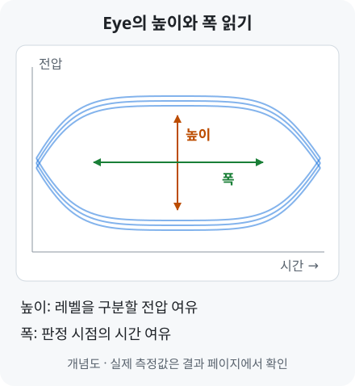
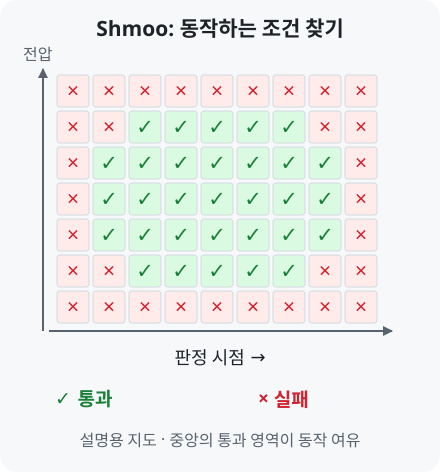

# Eye·BER·Shmoo | 측정 결과 읽기

[← 용어 안내](../glossary.md) · [연구 이력](../profile.md) · [홈](../../README.md)

**Eye는 신호를 구분할 전압·시간 여유, BER은 판정한 비트의 오류 비율, Shmoo는 조건별 동작 영역을 보여줍니다.**

## 1. Eye: 신호를 구분할 여유가 얼마나 있나요?

파형을 심볼 주기에 맞춰 여러 번 겹치면 눈처럼 열린 영역이 나타납니다. 이 그림이 **Eye diagram**입니다.

**Eye height**는 신호 레벨을 구분할 전압 여유, **Eye width**는 판정 시점의 시간 여유를 읽는 데 사용합니다. [Eye diagram 원리](https://helpfiles.keysight.com/csg/N1930xB/Analyzing/Analyzing_Data_using_Eye_Diagrams.html)

[PAM-3](pam-signaling.md#term-pam3)는 세 레벨 사이에 두 Eye가 생겨 상·하단을 함께 봅니다. **Timing opening**은 지정한 오류 기준을 만족하는 시간축 범위입니다.

[실제 USB 칩의 FFE off/on Eye 비교 →](../../projects/high-speed-interface-research/docs/pam3-differential-measurement.md#pam3-ffe-result)

## 2. BER: 비교한 비트 중 얼마나 틀렸나요?

**BER**(Bit Error Ratio)은 `오류 비트 수 ÷ 비교한 전체 비트 수`입니다. 설명용으로 1,000,000비트 중 10비트가 틀리면 `10 ÷ 1,000,000 = 10⁻⁵`입니다. [BER 정의](https://helpfiles.keysight.com/csg/89600B/Webhelp/Subsystems/flexframe/content/trc_carrier_summary.htm)

미리 알고 있는 비트열을 보내고 복원한 데이터와 비교하면 오류를 셀 수 있습니다. **PRBS**(Pseudo-Random Binary Sequence)는 이때 사용하는, 같은 규칙으로 다시 만들 수 있는 비트 패턴입니다.

이 연구에서는 RFSoC 내부 검사기의 오류 수와 비교 비트 수로 BER을 계산했습니다. [RFSoC 측정·BER 결과 →](../../projects/zcu208-pam4-dsp-portfolio/docs/validation.md#isi-보드를-통한-rfsoc-측정)

Eye는 파형의 여유를 보여주고, BER은 데이터를 판정한 결과를 평가합니다. 함께 보면 파형의 변화가 수신 성능에 어떻게 이어지는지 이해할 수 있습니다.

## 3. Shmoo: 어떤 조건까지 동작하나요?

전압과 판정 시점 등의 조건을 바꾸고, 각 조합의 통과·실패를 표시한 지도입니다. 통과 영역의 폭과 높이로 동작 여유를 살펴봅니다. [Shmoo 원리](https://www.ni.com/docs/en-US/bundle/ni-digital-pattern/page/shmoo-plot.html)

[실제 LPDDR Combo TX Eye·RX Shmoo 결과 →](../../projects/high-speed-interface-research/docs/lpddr-combo.md#lpddr-combo-result)

장비 더 보기 · AWG·BERT·오실로스코프

- **AWG:** 설정한 파형을 만들어 수신기에 입력합니다.
- **BERT:** 알려진 비트 패턴을 만들거나 수신 패턴과 비교해 비트 오류를 측정합니다.
- **오실로스코프:** 시간에 따른 전압 파형과 Eye를 관찰합니다.

[사용 장비와 측정 자동화](../../projects/high-speed-interface-research/docs/measurement-equipment.md)

---

[← 용어 안내](../glossary.md) · [연구 이력](../profile.md) · [홈](../../README.md) · [맨 위로](#page-top)
