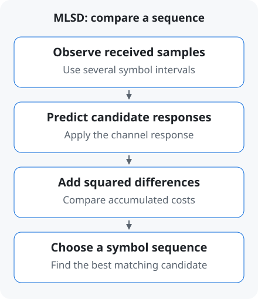

# MLSD | Recovering a transmitted symbol sequence

[← Term guide](../glossary.en.md) · [CV](../profile.en.md) · [Home](../../README.en.md)

**MLSD compares observations from several symbol times to find the most likely transmitted sequence.**

A **channel** is the path a signal travels, such as board traces or a cable. A symbol can leave an effect in later observations, making a single received value ambiguous. This is [intersymbol interference (ISI)](equalization.en.md#term-isi). MLSD uses the relationship between successive observations.

## 1. Predict the response of each candidate

For each candidate sequence, predict what the channel would deliver and compare it with the actual observations. In the example below, **a smaller sum of squared differences indicates a closer match**. [MLSE principles](https://www.mathworks.com/help/comm/ug/mlse-equalizers.html)

## 2. Compare two observations together

A **symbol** is one transmitted signal value. This illustration uses just two levels, `−1, +1`.

Assume the previous symbol is `+1` and the channel response is `current symbol + 0.5 × previous symbol`. A new `+1` therefore predicts `1.5`. Noise can change the received values; assume two observations are `(0.7,−1.5)`.

| Symbols | Prediction | Cost |
|---|---|---|
| `(+1,+1)` | `(1.5,1.5)` | 9.64 |
| `(+1,−1)` | `(1.5,−0.5)` | 1.64 |
| **`(−1,−1)`** | **`(−0.5,−1.5)`** | **1.44** |
| `(−1,+1)` | `(−0.5,0.5)` | 5.44 |

Cost is the sum of squared differences at the two times. For `(−1,−1)`, the differences are `1.2` and `0`, giving `1.2²+0²=1.44`.

For the first observation alone, `1.5` is closer to `0.7` than `−0.5`, favoring a first symbol of `+1`. Across both observations, **`(−1,−1)` provides the closer match**. Later evidence can change an earlier tentative decision.

## 3. Connect the example to PAM4 research

[PAM4](pam-signaling.en.md#term-pam4) has four levels and therefore more candidates. Hardware design considers **which candidates to retain while reducing computation**. This is the problem addressed by DS-SBM and the follow-up DP-SMM work.

[A-SSCC receiver architecture](../../projects/zcu208-pam4-dsp-portfolio/docs/architecture.md) · [RFSoC measurements and BER](../../projects/zcu208-pam4-dsp-portfolio/docs/validation.md#isi-보드를-통한-rfsoc-측정) · [How to read BER](measurements.en.md#term-ber)

Read more · States, metrics, survivors and research architectures

**MLSD** expands to Maximum-Likelihood Sequence Detection. Documentation also describes this family as **MLSE**, Maximum-Likelihood Sequence Estimation. The Viterbi algorithm efficiently compares candidate paths.

- **State:** a representation of previous symbols needed to predict observations.
- **Branch metric (BM):** mismatch cost for one candidate transition.
- **Path metric (PM):** cost accumulated along a path.
- **Survivor:** path or branch information retained for later comparisons.

With PAM4 and two previous symbols represented explicitly, there are `4 × 4 = 16` states. **RS-MLSD** (reduced-state MLSD) reduces states to lower hardware cost. [State count and algorithm](https://www.mathworks.com/help/comm/ref/comm.mlseequalizer-system-object.html)

**DS-SBM** propagates two survivor branches per visible state and combines segment-cost matrices. [A-SSCC design decisions](../../projects/zcu208-pam4-dsp-portfolio/docs/design-decisions.md)

**DP-SMM** retains two paths for each matrix element connecting the same start and end states, then reevaluates costs using actual symbol history. [Journal research](https://github.com/yunjuhyeong0916-glitch/pam4-mlsd-research/blob/main/projects/dp-smm-journal/README.md)

[← ISI and equalization example](equalization.en.md) · [Implementing RTL on an FPGA →](hardware-workflow.en.md)

---

[← Term guide](../glossary.en.md) · [CV](../profile.en.md) · [Home](../../README.en.md) · [Back to top](#page-top)
