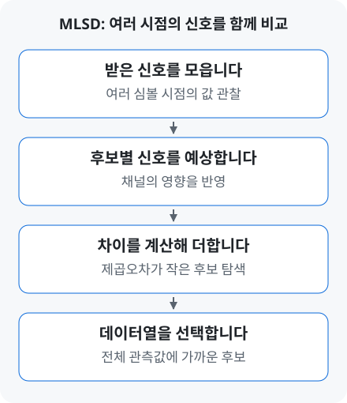

# MLSD | 연속된 신호에서 송신 데이터 찾기

[← 용어 안내](../glossary.md) · [연구 이력](../profile.md) · [홈](../../README.md)

**MLSD는 여러 시점에 받은 신호를 함께 비교해, 보냈을 가능성이 가장 높은 데이터열을 찾는 수신 기법입니다.**

신호가 지나가는 배선·케이블 등의 경로를 **채널**이라고 합니다. 채널을 통과한 신호에는 앞서 보낸 신호의 영향이 남을 수 있어, 한 번 받은 값만으로 데이터를 고르기 어려워집니다. 이것이 [ISI](equalization.md#term-isi)이며, MLSD는 여러 수신값의 관계를 함께 이용합니다.

## 1. 후보마다 어떤 신호가 도착할지 예상합니다

각 후보 데이터열을 채널에 보냈다고 가정하고 예상 수신값을 구합니다. 그 값과 실제 관측값의 차이를 비교해, 전체 관측값을 잘 설명하는 후보를 선택합니다. 아래 예제에서는 **차이를 제곱해 더한 값이 작을수록 더 잘 맞는 후보**로 봅니다. [MLSE 원리](https://www.mathworks.com/help/comm/ug/mlse-equalizers.html)

## 2. 두 번 받은 값을 함께 비교해 봅니다

한 번에 보내는 신호 값을 **심볼**이라고 합니다. 원리를 보기 위해 두 레벨 `−1, +1`만 사용하겠습니다.

이전 심볼은 `+1`, 채널의 영향은 `현재 심볼 + 0.5 × 이전 심볼`이라고 가정합니다. 예를 들어 다음 심볼이 `+1`이면 예상 수신값은 `1.5`입니다. 실제로는 잡음이 더해질 수 있으며, 여기서는 두 값이 `(0.7,−1.5)`로 관측되었다고 두겠습니다.

| 후보 | 예상값 | 비용 |
|---|---|---|
| `(+1,+1)` | `(1.5,1.5)` | 9.64 |
| `(+1,−1)` | `(1.5,−0.5)` | 1.64 |
| **`(−1,−1)`** | **`(−0.5,−1.5)`** | **1.44** |
| `(−1,+1)` | `(−0.5,0.5)` | 5.44 |

표의 비용은 두 시점의 차이를 제곱해 더한 값인 **제곱오차 합**입니다. 후보 `(−1,−1)`에서는 차이가 각각 `1.2`와 `0`이므로, `1.2²+0²=1.44`입니다.

첫 수신값 `0.7`만 보면 `1.5`가 `−0.5`보다 가까워 첫 심볼을 `+1`로 고를 수 있습니다. 두 수신값을 함께 비교하면 **`(−1,−1)`이 전체를 더 잘 설명**합니다. 뒤에 받은 정보가 앞선 판단을 바꿀 수 있다는 것이 핵심입니다.

## 3. 실제 PAM4 연구에서는 어떻게 사용하나요?

[PAM4](pam-signaling.md#term-pam4)는 네 레벨을 사용하므로 후보가 더 많아집니다. 하드웨어에서는 **계산량을 줄이면서 어떤 후보를 다음 비교에 남길지**를 함께 설계합니다. 이 포트폴리오의 DS-SBM과 후속 DP-SMM 연구가 다루는 문제입니다.

[A-SSCC 수신 구조](../../projects/zcu208-pam4-dsp-portfolio/docs/architecture.md) · [RFSoC 측정·BER 결과](../../projects/zcu208-pam4-dsp-portfolio/docs/validation.md#isi-보드를-통한-rfsoc-측정) · [BER 읽는 방법](measurements.md#term-ber)

더 자세히 보기 · State·BM·PM·survivor와 연구 구조

**MLSD**는 Maximum-Likelihood Sequence Detection의 약자입니다. 관련 자료에서는 같은 계열의 기법을 **MLSE**(Maximum-Likelihood Sequence Estimation)로도 설명합니다. Viterbi 알고리즘은 후보 경로를 효율적으로 비교하는 대표적인 방법입니다.

- **State:** 다음 신호를 예상하는 데 필요한 이전 심볼 이력의 구분.
- **Branch metric(BM):** 한 후보 전이와 관측값의 차이를 나타내는 비용.
- **Path metric(PM):** 경로를 따라 누적한 비용.
- **Survivor:** 비교 후 다음 계산에 남기는 후보 경로 또는 분기 정보.

PAM4에서 이전 두 심볼의 모든 조합을 상태로 두면 `4 × 4 = 16`개가 필요합니다. **RS-MLSD**(Reduced-State MLSD)는 상태를 줄여 하드웨어 비용을 낮추는 방향입니다. [상태 수와 알고리즘](https://www.mathworks.com/help/comm/ref/comm.mlseequalizer-system-object.html)

**DS-SBM**은 상태별 두 survivor branch와 구간별 비용 행렬의 결합을 사용합니다. [A-SSCC 설계 판단](../../projects/zcu208-pam4-dsp-portfolio/docs/design-decisions.md)

**DP-SMM**은 같은 시작·종료 상태를 연결하는 행렬 원소에 두 경로 후보를 남기고, 실제 심볼 이력을 반영해 비용을 다시 평가하는 후속 구조입니다. [Journal 연구](https://github.com/yunjuhyeong0916-glitch/pam4-mlsd-research/blob/main/projects/dp-smm-journal/README.md)

[← ISI·등화 예제](equalization.md) · [RTL·FPGA로 구현하기 →](hardware-workflow.md)

---

[← 용어 안내](../glossary.md) · [연구 이력](../profile.md) · [홈](../../README.md) · [맨 위로](#page-top)
