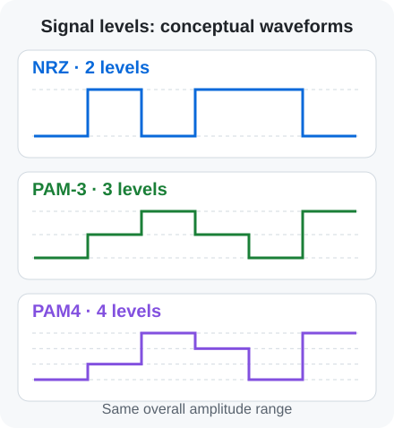

# PAM4, PAM-3 and NRZ | Signal levels and data rates

[← Term guide](../glossary.en.md) · [CV](../profile.en.md) · [Home](../../README.en.md)

**NRZ, PAM-3 and PAM4 represent data using signal amplitude levels.** In this portfolio, they refer to two-, three- and four-level signaling respectively.

A **symbol** is one value chosen from the signaling alphabet. Two-level NRZ represents one bit per symbol; PAM4 can represent two. [Keysight: bits versus symbols](https://helpfiles.keysight.com/scopes/FlexDCA-PG/Content/Topics/Quick-Start/theory_bits_vs_symbols.htm)

## Why use PAM4?

It carries more bits at the same symbol rate. For example, **2-GBd PAM4 corresponds to 4 Gb/s before coding overhead**.

For the same overall voltage range, adjacent levels are closer together than in two-level signaling. This makes [equalization](equalization.en.md) and detection methods such as [MLSD](mlsd.en.md) useful for handling distortion and noise. [Tektronix PAM4 overview](https://www.tek.com/de/blog/time-get-ready-pam4)

## How does PAM-3 carry bits?

Three levels do not map directly to the four combinations of a two-bit word. Coding can instead map a block of bits to a sequence of symbols. The USB TX model here uses **11B7S encoding: 11 bits mapped to seven symbols**. [USB TX modeling](../../projects/high-speed-interface-research/docs/usb-tx-modeling.md)

USB4 Version 2.0 introduced a PAM3-based physical layer. The USB4 Gen4 work in this portfolio covers transmitter and receiver modeling and TX evaluation using that signaling approach. [USB-IF announcement](https://www.usb.org/sites/default/files/2022-10/USB-IF%20USB%2080Gbps%20Announcement_FINAL_v2.pdf)

## Reading Gb/s, GBd, GS/s and UI

- **Gb/s:** billions of bits per second.
- **GBd or GBaud:** billions of symbols per second. A PAM4 symbol represents two bits.
- **GS/s:** billions of samples per second at a converter or sample-processing interface. The samples-per-symbol setting relates this to symbol rate.
- **UI (Unit Interval):** the nominal duration of one PAM symbol here. At `2 GBd`, `1 UI = 0.5 ns`.

Separating these quantities helps distinguish circuit data rate from FPGA sample throughput. [Rate and UI definitions](https://helpfiles.keysight.com/scopes/FlexDCA-PG/Content/Topics/Quick-Start/theory_bits_vs_symbols.htm)

[Next: overlapping symbols and equalization →](equalization.en.md)

## Related research

[NRZ TX circuit](../../projects/high-speed-interface-research/docs/lpddr-tx-circuit-verification.md) · [USB PAM-3](../../projects/high-speed-interface-research/docs/usb4-pam3.md) · [PAM4 DSP](../../projects/zcu208-pam4-dsp-portfolio/)

---

[← Term guide](../glossary.en.md) · [CV](../profile.en.md) · [Home](../../README.en.md) · [Back to top](#page-top)
