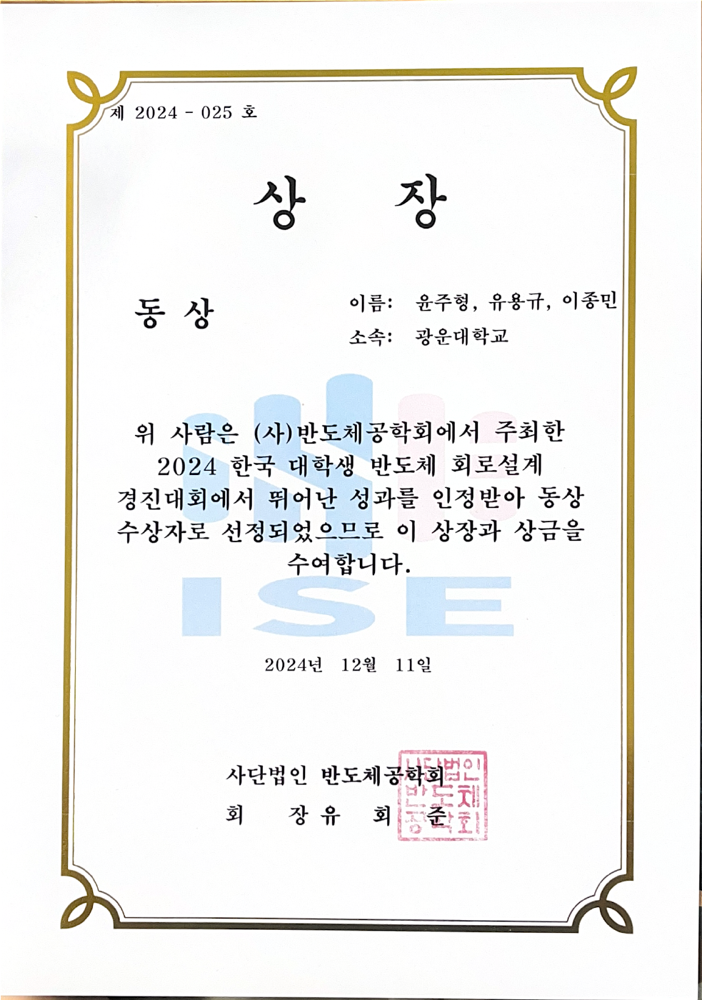

# Juhyeong Yun | CV

**Email:** [wngud1074@kw.ac.kr](mailto:wngud1074@kw.ac.kr)

  
  

I design and verify [JEDEC LPDDR](concepts/interfaces.en.md#term-lpddr) and [USB4 Gen4](concepts/interfaces.en.md#term-usb4) interface circuits and [DSP](concepts/hardware-workflow.en.md#term-dsp)-based transceivers for ultra-high-speed communication.

## Education

- **Kwangwoon University**  M.S. program, Electronics and Communications Engineering  Sep 2024–present · Coursework completed Aug 2026  **Expected graduation: Feb 2027**  **GPA: 4.35/4.50**
- **Kwangwoon University**  B.S., Electronic Convergence Engineering  Transferred Mar 2022 · Graduated Aug 2024  **GPA: 3.60/4.50**
- **Baekseok University**  Undergraduate studies in Information Security, ICT Division  Enrolled Mar 2017 · Before transfer to Kwangwoon University

## Awards

**2024 Korean University Student Semiconductor Circuit Design Competition**  **Bronze Award · Team award**

11 Dec 2024 · ISE (반도체공학회)

The team received the award for a low-voltage, low-power NRZ transceiver in 28-nm CMOS. I was responsible for **[TX](concepts/interfaces.en.md#term-phy) circuit design and verification**. [Related TX design and verification](../projects/high-speed-interface-research/docs/lpddr-tx-circuit-verification.en.md#page-top)

  <a href="../assets/profile/award-2024-circuit-design-bronze.png?raw=true" title="View full-size award certificate">
     
    View award certificate
  </a>

## Research projects

### 01 · DSP transceiver research

#### Semiconductor design technology for 200+Gb/s-class next-generation ultra-high-speed interfaces

> **Participation period:** 1 Apr 2026–31 Dec 2026 **(in progress)**  **Position:** Student researcher  **Funding administration:** Sungkyunkwan University (산학협력단)

**Role:** [PAM4](concepts/pam-signaling.en.md#term-pam4) TX/RX filter and [MLSD](concepts/mlsd.en.md#page-top "Detection using a sequence of received observations") detector [RTL](concepts/hardware-workflow.en.md#term-rtl) design, [RFSoC](concepts/hardware-workflow.en.md#term-fpga-rfsoc) integration and board validation. [DSP-based transceiver research](../projects/zcu208-pam4-dsp-portfolio/README.en.md#page-top)

I use [AI and MATLAB MCP](ai-assisted-dsp-workflow.en.md#page-top) for RTL, testbench and automation code supporting repeatable verification and measurements.

---

### 02 · LPDDR interface research

#### Memory Interface Architecture exploration and validation

> **Participation period:** 1 Jan 2025–31 Dec 2026 **(in progress)**

**Role:** DQ TX circuit design and verification, TX Verilog modeling, measurement PCB design and HFSS analysis. [LPDDR Combo design and verification](../projects/high-speed-interface-research/docs/lpddr-combo.en.md#page-top)

#### Next-generation LPDDR 5/6-class memory interface IP technology development

> **Participation period:** 4 Sep 2023–30 Aug 2024  **Position:** Undergraduate intern  **Commissioning organization:** KEIT (한국산업기술평가관리원)

**Role:** 15.6-Gb/s low-voltage TX circuit design, schematic and post-layout verification. [LPDDR TX circuit design and verification](../projects/high-speed-interface-research/docs/lpddr-tx-circuit-verification.en.md#page-top)

---

### 03 · USB interface research

#### Terabit-scale light-field display system development based on Near-display processing (NDP)

> **Participation period:** 1 Apr 2024–31 Dec 2026 **(in progress)**  **Position:** Student researcher  **Funding:** National Research Foundation of Korea  **Funding administration:** Hanyang University

**Role:** USB4 Gen4 TX RTL and RX CTLE modeling, transceiver integration checks, and participation in differential PAM&#8209;3 TX silicon measurements. [USB4 design and verification](../projects/high-speed-interface-research/docs/usb4-pam3.en.md#page-top)

---

## Selected publications

### DSP-based transceivers

- **A-SSCC 2026 · First author · Accepted:** [DS-SBM RFSoC PAM4 transceiver](https://epapers2.org/asscc2026/ESR/paper_details.php?paper_id=1351)

### LPDDR interfaces

- **A-SSCC 2026 · Co-author · Accepted:** [LPDDR4X/5/5X Combo PHY](https://epapers2.org/asscc2026/ESR/paper_details.php?paper_id=1141)
- **ICEIC 2025 · Co-first author:** [15.6-Gb/s low-voltage NRZ TX](https://doi.org/10.1109/ICEIC64972.2025.10879746)

### USB interfaces

- **IEEE TVLSI 2026 · Co-first author:** [PAM&#8209;3 TX with 150-preset four-tap FFE](https://doi.org/10.1109/TVLSI.2026.3701343)
- **SMACD 2025 · Co-first author:** [USB4 Gen4 PAM&#8209;3 TX model](https://doi.org/10.1109/SMACD65553.2025.11092283)
- **SMACD 2025 · Co-first author:** [PAM&#8209;3 RX model](https://doi.org/10.1109/SMACD65553.2025.11092233)

[Full paper titles and validation scope](publications.en.md#page-top)

## Ongoing papers and patent preparation

- [Master’s thesis · DS-SBM design and RFSoC verification](https://github.com/yunjuhyeong0916-glitch/pam4-mlsd-research/blob/main/projects/pam4-mlsd-thesis/README.en.md#page-top) **(manuscript being finalized)**
- [Journal · DP-SMM design and verification](https://github.com/yunjuhyeong0916-glitch/pam4-mlsd-research/blob/main/projects/dp-smm-journal/README.en.md#page-top) **(in progress)**
- [DP-SMM patent application in preparation](https://github.com/yunjuhyeong0916-glitch/pam4-mlsd-research/blob/main/docs/publications.en.md#page-top)

---

  
  

