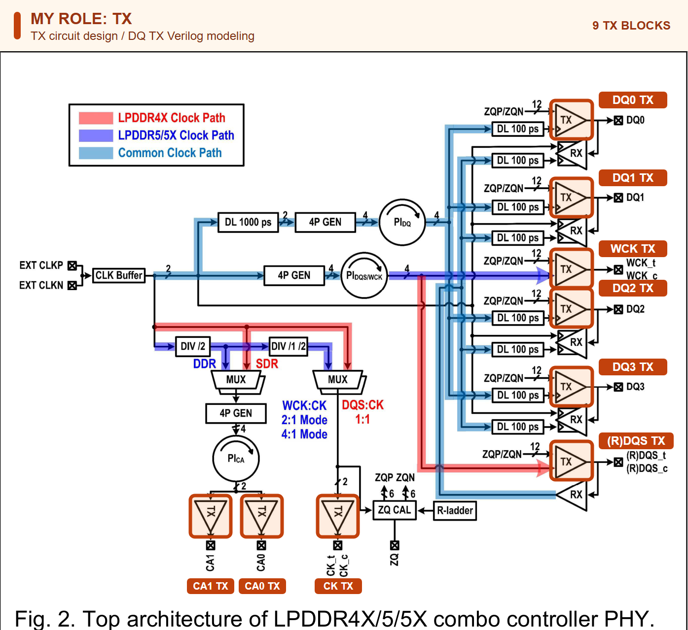

# LPDDR Combo | TX design, modeling and silicon evaluation

[Home](https://github.com/yunjuhyeong0916-glitch/jhyun/blob/main/README.en.md#page-top) · [Project](lpddr.en.md#page-top) · [Detailed notes (Korean)](lpddr-combo.md#page-top)

The LPDDR4X/5/5X Combo Controller PHY shares clock-generation and phase-alignment resources and switches signal paths by operating mode.

**My role:** TX circuit design and DQ TX Verilog behavioral modeling, measurement PCB design/HFSS analysis and participation in silicon evaluation. **A-SSCC 2026 · Co-author · Accepted.**

## Top architecture

The red, purple and light-blue paths represent LPDDR4X, LPDDR5/5X and common clock paths, respectively. Orange outlines mark all **nine TX blocks**: DQ0–DQ3, CA0/1, CK, WCK and (R)DQS. My work covers TX circuit design/verification and DQ TX Verilog modeling. [A-SSCC 2026 Fig. 2](https://epapers2.org/asscc2026/ESR/paper_details.php?paper_id=1141)

## Silicon results

<table width="715">
<thead><tr><th align="center" width="50%">TX Eye</th><th align="center" width="50%">RX Shmoo</th></tr></thead>
<tbody><tr>
<td align="center" valign="top"></td>
<td align="center" valign="top"></td>
</tr></tbody>
</table>

**Conditions:** 28-nm CMOS, 14 Gb/s/pin, four DQs active. TX eye opening is **0.41 UI / 65.3 mV**; RX timing/voltage margin is **0.25 UI / 25 mV** with TX and RX connected. [A-SSCC Fig. 5](https://epapers2.org/asscc2026/ESR/paper_details.php?paper_id=1141)

## TX modeling

The TX model connects 32-bit input serialization, phase alignment and main/one-UI-delayed paths to pre-emphasis. I checked bit order, relative timing and DQ0–DQ3 outputs in the integrated model. The single-TX model uses **20 Gb/s PRBS7** and **12.5-dB channel loss at 10 GHz**. [Model waveforms and code-dependent eyes (Korean)](lpddr-tx-modeling.md#page-top)

## PCB and HFSS

I designed the measurement PCB’s circuit, placement and routing, and modeled the pad-to-connector signal/ground/via structure in HFSS. Power/GND and COB connections support the chip evaluation. [Board design, images and transmission results](pcb-hfss-verification.en.md#page-top)

[A-SSCC paper](https://epapers2.org/asscc2026/ESR/paper_details.php?paper_id=1141) · [Low-voltage TX circuit](lpddr-tx-circuit-verification.en.md#page-top)

---

[Home](https://github.com/yunjuhyeong0916-glitch/jhyun/blob/main/README.en.md#page-top) · [Project](lpddr.en.md#page-top) · [Detailed notes (Korean)](lpddr-combo.md#page-top) · [Back to top](#page-top)
