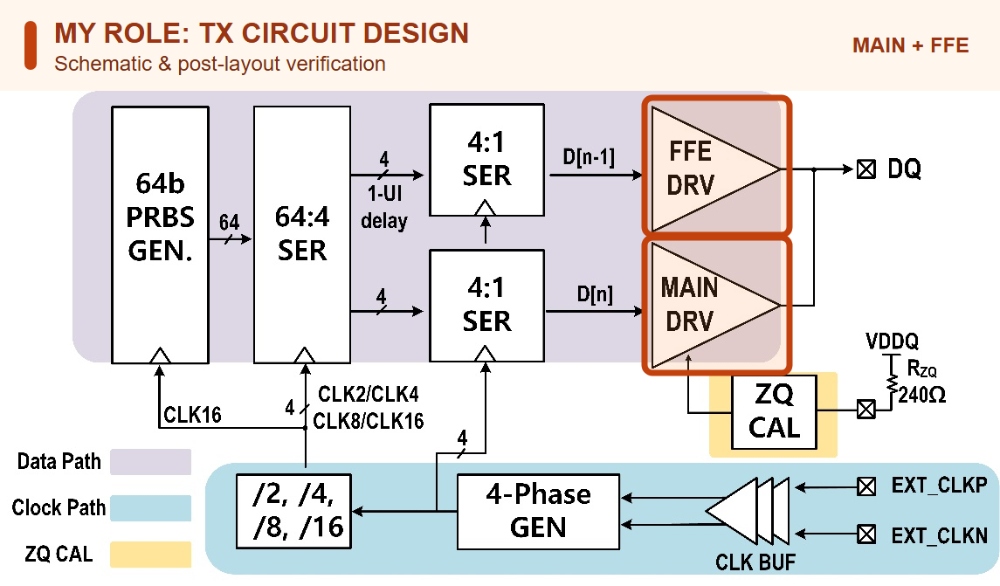

# LPDDR 15.6 Gb/s | Low-voltage TX circuit design

[Home](https://github.com/yunjuhyeong0916-glitch/jhyun/blob/main/README.en.md#page-top) · [Project](lpddr.en.md#page-top) · [Detailed notes (Korean)](lpddr-tx-circuit-verification.md#page-top)

To compensate channel loss at a **0.5-V driver supply**, I designed the TX circuit and verified its schematic and extracted post-layout netlist. The driver combines main and one-UI-delayed data for de-emphasis.

**My role:** 28-nm CMOS TX circuit design and schematic/post-layout verification. **ICEIC 2025 · Co-first author.**

## Top architecture

Orange outlines mark my main/FFE driver circuit-design and schematic/post-layout verification work. The 64-bit PRBS stream passes through 64:4 and 4:1 serializers. Main and one-UI-delayed data feed the main/FFE drivers; the clock path and ZQ block support the TX. [ICEIC 2025 Fig. 2](https://doi.org/10.1109/ICEIC64972.2025.10879746)

## FFE comparison

<table width="715">
<thead><tr><th align="center" width="50%">FFE OFF</th><th align="center" width="50%">FFE ON</th></tr></thead>
<tbody><tr>
<td align="center" valign="top"></td>
<td align="center" valign="top"></td>
</tr></tbody>
</table>

| Eye | FFE OFF | FFE ON |
|---|---:|---:|
| Width | 37 ps | **45.4 ps** |
| Height | 56.5 mV | **75.1 mV** |

**Simulation conditions:** 15.6 Gb/s, internal supply 1.05 V, driver supply 0.5 V and channel loss 8.7 dB.

## Post-layout verification

I checked LVS, extracted parasitics and simulated the extracted netlist in FineSim. A 127-bit PRBS7 period of about 8.14 ns corresponds to 15.6 Gb/s. The two supply contributions total about **11.93 mW**, or **0.76 pJ/bit**.

[ICEIC paper](https://doi.org/10.1109/ICEIC64972.2025.10879746) · [LPDDR Combo silicon evaluation](lpddr-combo.en.md#page-top)

---

[Home](https://github.com/yunjuhyeong0916-glitch/jhyun/blob/main/README.en.md#page-top) · [Project](lpddr.en.md#page-top) · [Detailed notes (Korean)](lpddr-tx-circuit-verification.md#page-top) · [Back to top](#page-top)
