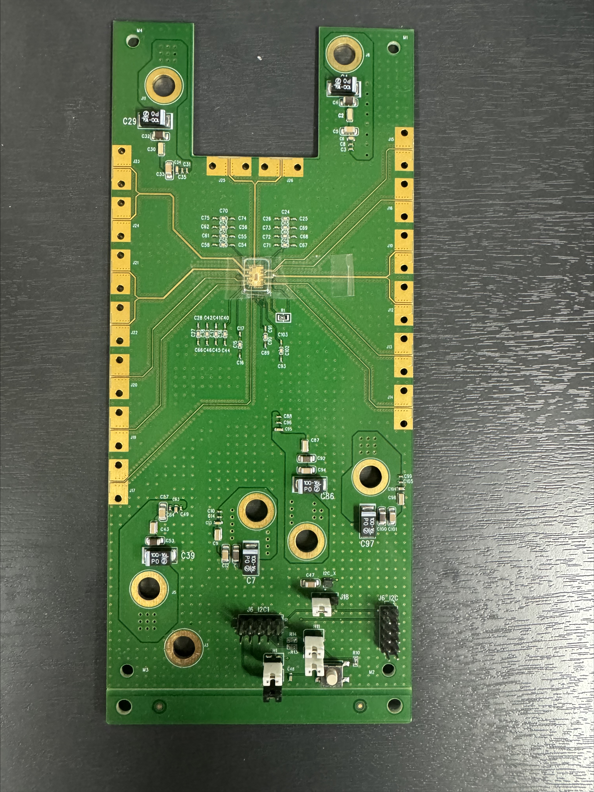
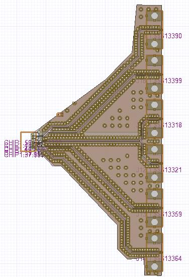
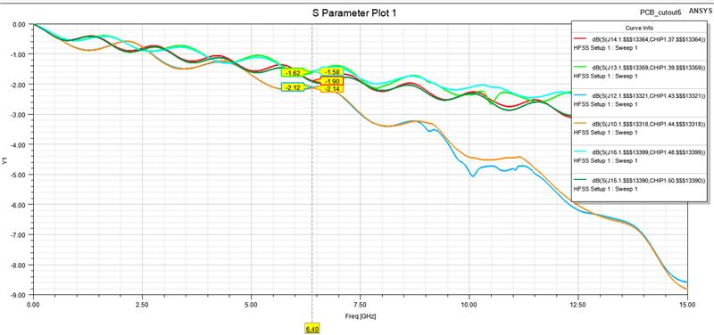

# PCB design and HFSS analysis

[Home](https://github.com/yunjuhyeong0916-glitch/jhyun/blob/main/README.en.md#page-top) · [Project](../README.en.md#page-top) · [Detailed notes (Korean)](pcb-hfss-verification.md#page-top)

I designed the **LPDDR measurement PCB’s circuit, placement and routing** and analyzed its transmission characteristics in HFSS. For the USB TX board, I reviewed GND vias, power delivery and connector clearance, and participated in chip evaluation.

## Board and electromagnetic model

| Measurement PCB | Pad-to-connector HFSS model |
|---|---|
|  |  |

The HFSS analysis workflow imports PADS ODB++, checks stackup/materials/thickness and ports/reference ground, and validates the model. I examined frequency-dependent loss and notches to review placement and routing.

## Transmission results

The LPDDR model gives **−1.58 to −2.14 dB across six transmission paths at 6.4 GHz**. In the USB model, loss at 12.8 GHz is about **1.11 dB for CLK** and **1.25 dB for DATA**. These are HFSS electromagnetic-analysis results.

[LPDDR Combo silicon results](lpddr-combo.en.md#lpddr-combo-result) · [USB differential measurements](pam3-differential-measurement.en.md#page-top)

---

[Home](https://github.com/yunjuhyeong0916-glitch/jhyun/blob/main/README.en.md#page-top) · [Project](../README.en.md#page-top) · [Detailed notes (Korean)](pcb-hfss-verification.md#page-top) · [Back to top](#page-top)
