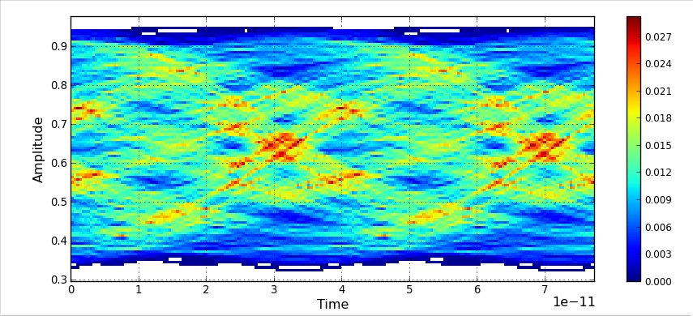
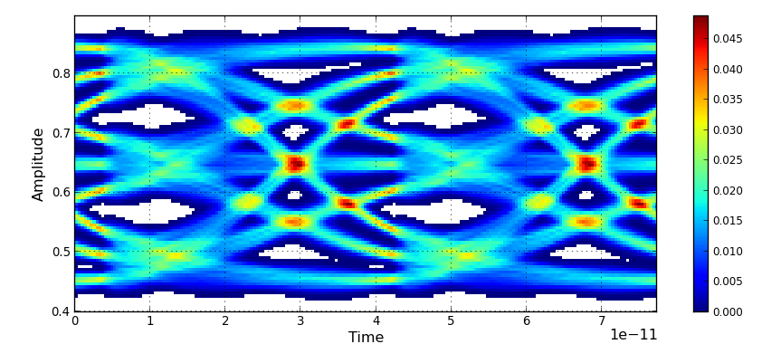

# USB RX CTLE | Operating point and compensation

[Home](https://github.com/yunjuhyeong0916-glitch/jhyun/blob/main/README.en.md#page-top) · [Project](usb4-pam3.en.md#page-top) · [Detailed notes (Korean)](usb-rx-ctle-modeling.md#page-top)

I modeled the CTLE and verified its integration into the RX. Fixing the bias and input common-mode condition before sweeping R/C made it possible to compare frequency response without changing several operating-point variables at once.

## CTLE input/output comparison

<table>
<thead><tr><th align="center" width="50%">CTLE input</th><th align="center" width="50%">CTLE output</th></tr></thead>
<tbody><tr>
<td align="center" valign="top"></td>
<td align="center" valign="top"></td>
</tr></tbody>
</table>

**Conditions:** scrambled PAM-3 data, TX FFE off, selected CTLE setting in the integrated model.

## Design decisions

I adjusted the XMODEL device operating point and RZ/CZ controls, compared AC responses and checked middle-level stability. Connecting the CTLE to the sampler also required checking load and common-mode conditions; the standalone 850-mV common-mode setting became about 700 mV in RX integration.

The related **25.6-GBaud/lane RX model** includes CTLE, DFE and CDR. My contribution covers CTLE modeling and integrated RX verification. [SMACD RX model paper](https://doi.org/10.1109/SMACD65553.2025.11092233)

[TX modeling](usb-tx-modeling.en.md#page-top) · [TX silicon measurements](pam3-differential-measurement.en.md#page-top)

---

[Home](https://github.com/yunjuhyeong0916-glitch/jhyun/blob/main/README.en.md#page-top) · [Project](usb4-pam3.en.md#page-top) · [Detailed notes (Korean)](usb-rx-ctle-modeling.md#page-top) · [Back to top](#page-top)
