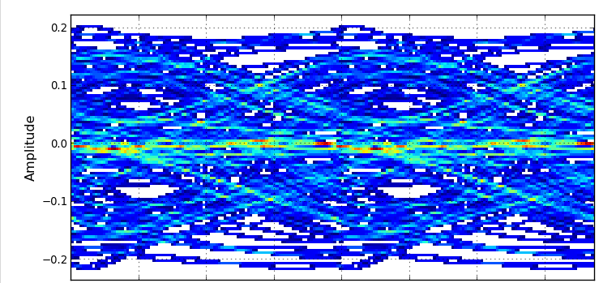
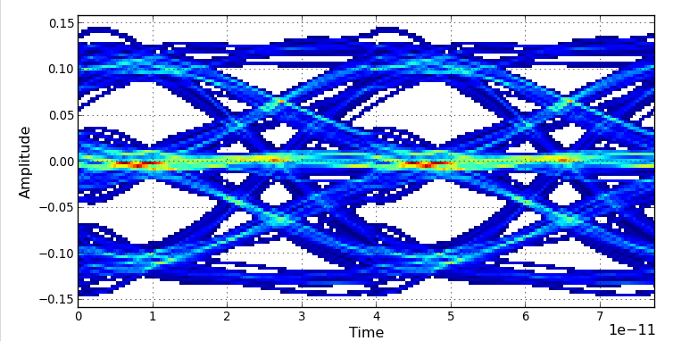

# USB TX | Logic RTL and electrical-layer modeling

[Home](https://github.com/yunjuhyeong0916-glitch/jhyun/blob/main/README.en.md#page-top) · [Project](usb4-pam3.en.md#page-top) · [Detailed notes (Korean)](usb-tx-modeling.md#page-top)

The TX model needs the encoder, scrambler, serializers and driver to agree on symbol codes and bit order. I implemented TX logic RTL/XMODEL integration, checked serializer stages and compared logic outputs after synthesis/P&R and electrical-layer integration.

## Channel-included FFE comparison

<table>
<thead><tr><th align="center" width="50%">FFE OFF · Preset 0</th><th align="center" width="50%">FFE ON · Preset 7</th></tr></thead>
<tbody><tr>
<td align="center" valign="top"></td>
<td align="center" valign="top"></td>
</tr></tbody>
</table>

**Model conditions:** 25.6 GBaud, 1 UI = 39.0625 ps, VDD 1 V, tail-current setting 5 mA, channel loss 9.89 dB at 12.8 GHz. The model uses ideal current sources and manually selected coefficients.

FFE coefficients

Order: `C[-2], C[-1], C[0], C[1]`.

- **Preset 0:** `0, 0, 1, 0`
- **Preset 7:** `0, -0.05, 0.8, -0.15`

## Verification approach

Sixteen 11B7S encoders map 176 input bits to 112 PAM-3 symbols represented on a 224-bit bus. I independently calculated encoder/scrambler expectations and tracked MSB/LSB ordering through serialization. RTL, P&R netlist and electrical-layer outputs were compared using VCS and POSIM.

[SMACD TX model paper](https://doi.org/10.1109/SMACD65553.2025.11092283) · [TX silicon measurements](pam3-differential-measurement.en.md#page-top) · [RX CTLE](usb-rx-ctle-modeling.en.md#page-top)

---

[Home](https://github.com/yunjuhyeong0916-glitch/jhyun/blob/main/README.en.md#page-top) · [Project](usb4-pam3.en.md#page-top) · [Detailed notes (Korean)](usb-tx-modeling.md#page-top) · [Back to top](#page-top)
