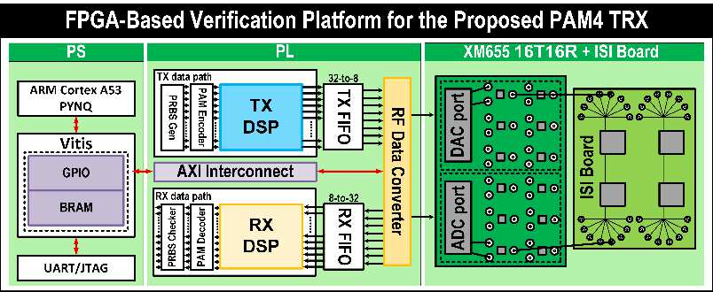

# A-SSCC 2026 | DS-SBM PAM4 transceiver DSP

[Home](https://github.com/yunjuhyeong0916-glitch/jhyun/blob/main/README.en.md#page-top) · [Detailed notes (Korean)](README.md#page-top)

I implemented the transceiver DSP, detector RTL and RFSoC control path to evaluate PAM4 recovery through a physical ISI channel. The work was **accepted at A-SSCC 2026; first author**.

**My role:** TX/RX filter and DS-SBM detector RTL design, RFSoC integration, board control and validation.

[Results](docs/validation.en.md#page-top) · [Top architecture](#asscc-top-architecture) · [Architecture](docs/architecture.en.md#page-top) · [Vitis bring-up](docs/vitis-bringup.en.md#page-top) · [AI-assisted workflow](../../docs/ai-assisted-dsp-workflow.en.md#page-top)

## Top architecture

The PS controls TX/RX settings, while the PL data paths connect through the RF Data Converter to the DAC → ISI board → ADC path. [Block roles and parallel processing](docs/architecture.en.md#asscc-top-architecture)

## Board measurements and FPGA results

**Setup:** 4 GS/s, uncoded PAM4 8 Gb/s. The estimated total DAC–ISI-board–ADC path loss is about 41 dB at 2 GHz. At the selected PR response for each pattern, the reported BER is **< 10⁻⁷ for PRBS7** and **< 2×10⁻⁶ for PRBS15**.

| Detector | LUT | FF |
|---|---:|---:|
| RS-ACS | 258k | 80k |
| **DS-SBM** | **166k** | **62k** |
| **Reduction** | **35.7%** | **22.5%** |

The comparison covers the detector. The complete transceiver uses 189,108 LUTs, 188,846 FFs, 950 DSPs and 24.5 BRAM tiles. [Measurement conditions, resource scope and timing](docs/validation.en.md#page-top)

## Design choices

The RX path uses a **21-tap FFE → 3-tap PR filter → DS-SBM**. Separate FFE and PR settings let channel compensation and the response used by the detector be adjusted independently.

DS-SBM propagates two survivor branches per reduced state and combines segment metric matrices to handle the sequential dependency of ACS updates. The RTL processes **32 symbols per clock**. [Architecture and implementation](docs/architecture.en.md#page-top)

## Board control and automation

A Cortex-A53 Standalone application initializes CLK104 and RFDC, writes RX coefficients through AXI BRAM, commits the updates and reads capture data. The automation harness connects Vitis builds, XSCT launch, UART capture and Python analysis. [Vitis sequence](docs/vitis-bringup.en.md#page-top) · [Toolbox and harness roles](../../docs/ai-assisted-dsp-workflow.en.md#page-top)

## Related research

[A-SSCC paper](https://epapers2.org/asscc2026/ESR/paper_details.php?paper_id=1351) · [DS-SBM master’s thesis](https://github.com/yunjuhyeong0916-glitch/pam4-mlsd-research/blob/main/projects/pam4-mlsd-thesis/README.en.md#page-top) · [DP-SMM follow-up journal project](https://github.com/yunjuhyeong0916-glitch/pam4-mlsd-research/blob/main/projects/dp-smm-journal/README.en.md#page-top)

---

[Home](https://github.com/yunjuhyeong0916-glitch/jhyun/blob/main/README.en.md#page-top) · [Detailed notes (Korean)](README.md#page-top) · [Back to top](#page-top)
