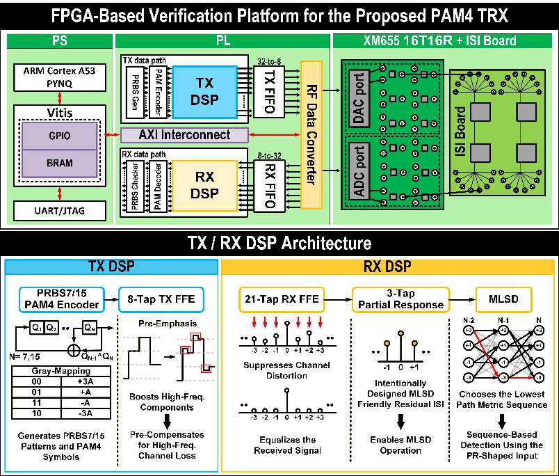

# DS-SBM | Transceiver architecture

[Home](https://github.com/yunjuhyeong0916-glitch/jhyun/blob/main/README.en.md#page-top) · [Project](../README.en.md#page-top) · [Detailed notes (Korean)](architecture.md#page-top)

The signal path is **PRBS/PAM4 generation → 8-tap TX FFE → DAC → ISI board → ADC → 21-tap RX FFE → 3-tap PR filter → DS-SBM → PRBS checker**. The PS configures the PL and the converters. [A-SSCC Fig. 2](https://epapers2.org/asscc2026/ESR/paper_details.php?paper_id=1351)

## 32-symbol parallel processing

The ADC-side datapath processes **32 samples per clock at 125 MHz**, giving 4 Gsamples/s. Fixed-point arithmetic and pipeline alignment connect the filters, metrics, survivor information and output-valid timing.

## Reduced states and segmented metrics

DS-SBM uses **four reduced states (visible states), each propagating two survivor branches**. It divides 32 symbols into eight four-symbol segments and combines their metric matrices through min-plus composition. This organizes parallel computation around the sequential dependency of symbol-by-symbol ACS updates.

RX FFE coefficients compensate the channel. The separate three-tap PR filter shapes the residual response used to predict detector observations. [Design rationale and equations (Korean)](design-decisions.md#page-top)

[Results and detector resource comparison](validation.en.md#page-top) · [PS/PL control](vitis-bringup.en.md#page-top)

---

[Home](https://github.com/yunjuhyeong0916-glitch/jhyun/blob/main/README.en.md#page-top) · [Project](../README.en.md#page-top) · [Detailed notes (Korean)](architecture.md#page-top) · [Back to top](#page-top)
