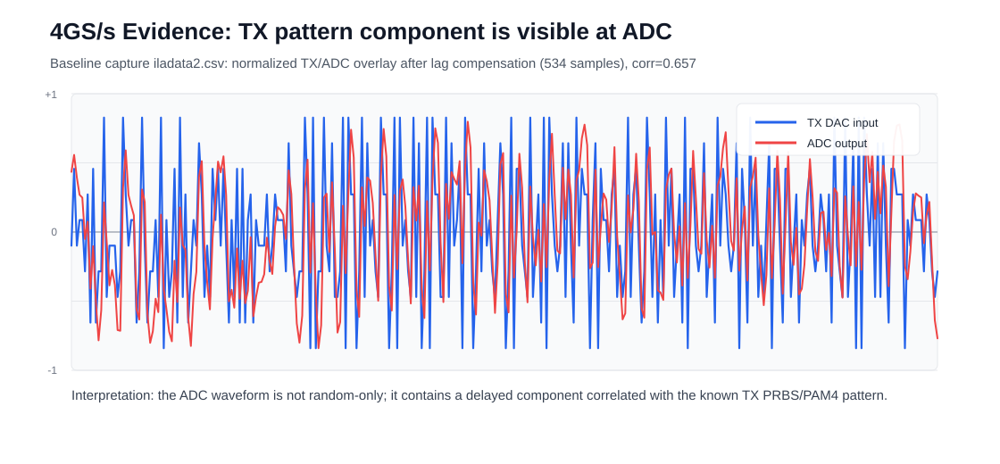

# ADC 캡처·재생과 통계 추정 분석

[A-SSCC 측정·구현 결과](validation.md#page-top) · [프로젝트](../README.md#page-top)

수신 경로 개발 과정에서 저장한 ADC 파형, 시뮬레이션 재생과 EQ 잔차 통계 분석을 정리했습니다. 날짜별 입력·계수·관측량을 각 결과와 함께 기록했습니다. 논문의 대표 성과는 [측정·검증 결과](validation.md#page-top)에서 볼 수 있습니다.

## ADC 캡처 파형·채널 응답

TX–ADC 파형 비교와 SBR·TX FFE 후보 분석

2026-06-10 RFDC ILA에서 DAC 입력과 ADC 출력을 비교했습니다. 두 slot의 valid/ready는 각각 1,024/1,024였고, ADC peak는 5,700 counts(약 17.4% FS)였습니다. 지연을 맞춘 TX–ADC 정규화 상관계수는 0.657, 지연은 534샘플입니다.

**분석 조건:** 2026-06-10 RFDC ILA 캡처의 지연 보상·정규화 비교.

2026-06-11 SBR 캡처는 256개 펄스 중 240개 유효 창을 사용했습니다. baseline은 −544 counts, 주응답은 baseline 대비 약 6,782 counts였고, 주응답으로 정규화한 이전·다음 응답은 0.559·0.744였습니다. 인접 심볼에 걸친 ISI를 관측했습니다.

| TX FFE 후보 캡처 | 값 |
|---|---:|
| ADC peak | 5,884 counts, 약 18.0% FS |
| TX–ADC 상관계수 | 0.731 |
| 최소제곱 채널 적합 상관계수 | 0.932 |
| TX rail hit 비율 | 9.41% |
| EQ 출력 범위 | −74 ~ +96 |

**분석 조건:** 2026-06-11 SBR·TX FFE 후보 캡처의 채널 적합 결과.

## ADC 캡처 재생·통계 분석

저장 ADC 입력의 PRBS7 시뮬레이션 재생

### PRBS7 캡처 재생

2026-06-13 저장 ADC 입력을 시뮬레이션에서 재생했습니다. 각 경로에 1,024프레임을 입력했고 유효 출력 행은 1,023개였습니다. PR 계수는 [256, 140, 0], 레벨은 [−22, −7, 7, 22], 임계값은 [−14, 0, 14]입니다.

| 경로 | Checker lock | 평가 비트 | 오류 | BER |
|---|---:|---:|---:|---:|
| EQ-only | 0 | 0 | 0 | 평가 미성립 |
| MLSD | 1 | 64,384 | 794 | 0.0123323 |

**출처:** 2026-06-13 캡처 재생 결과. 관측 비트 65,536개 중 lock 이후 64,384개를 BER 분모로 사용했습니다.

## EQ 잔차 통계로 계산한 기대 BER

2026-06-14 분석은 EQ 잔차의 평균·표준편차와 심볼 문맥별 횟수로 기대 BER를 계산했습니다. PRBS7은 ADC 캡처 입력, PRBS15는 IL40-dB 등가 입력에 결정적 AWGN을 더한 SNR 22-dB 조건입니다.

| 항목 | PRBS7 | PRBS15 |
|---|---:|---:|
| 최적 PR 계수 | [256, 148, −16] | [256, 112, −80] |
| 정규화된 post1, post2 | (0.578125, −0.0625) | (0.4375, −0.3125) |
| 기대 BER | 5.071389105066×10⁻¹² | 2.243856315445×10⁻⁶ |
| 10⁷비트 기준 기대 오류 | 0.000050714 | 22.438563154 |
| 10⁷비트 기준 표시 | 10⁻⁷ 하한 | 2.2×10⁻⁶ |

기대 오류는 계산한 BER에 평가 비트 수를 곱한 값입니다. 표의 10⁷비트 기준 표시는 기대 BER에 10⁻⁷의 표시 하한을 적용했습니다.

[측정·구현 결과](validation.md#page-top) · [홈](https://github.com/yunjuhyeong0916-glitch/jhyun#page-top) · [맨 위로](#page-top)
