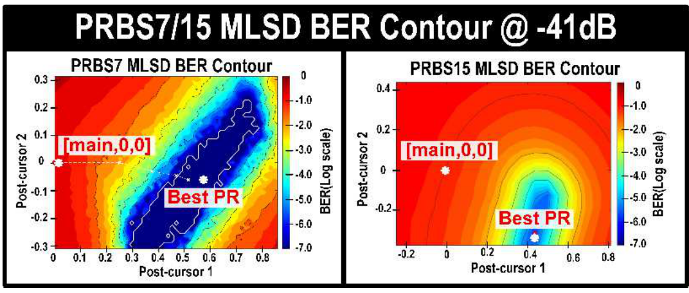

# A-SSCC DS-SBM PAM4 DSP 측정·검증 결과

<!-- page-navigation:top -->

  
  

<!-- /page-navigation:top -->

[개념부터: Eye·BER·Shmoo](../../../docs/concepts/measurements.md#page-top) · [설계 구조](architecture.md#page-top) · [MLSD 설계 판단](design-decisions.md#page-top) · [보드 초기화·제어 (Vitis)](vitis-bringup.md#page-top) · [논문](../../../docs/publications.md#page-top)

기준일: **2026-10-07**.

## ISI 보드를 통한 RFSoC 측정

측정 신호 경로는 **ZCU208 DAC → ISI 보드 → ADC 캡처**입니다.

A-SSCC 2026, p. 2 Fig. 6 상단. 왼쪽은 ZCU208·XM655와 ISI 보드의 실제 측정 구성, 오른쪽은 ISI 보드와 DAC–ADC 경로를 포함한 약 41-dB 손실 조건입니다. [논문 정보](https://epapers2.org/asscc2026/ESR/paper_details.php?paper_id=1351)

| 항목 | 결과 | 출처 |
|---|---|---|
| 채널 손실 | 41 dB | A-SSCC 2026, p. 2 Fig. 5 |
| PRBS7 BER | < 10⁻⁷ | 동일 그림의 RFSoC 시스템 결과 |
| PRBS15 BER | < 2×10⁻⁶ | 동일 그림의 RFSoC 시스템 결과 |

[BER·PRBS 읽는 방법](../../../docs/concepts/measurements.md#term-ber) · [논문 공식 정보](https://epapers2.org/asscc2026/ESR/paper_details.php?paper_id=1351)

## PR 응답에 따른 BER 컨투어

21-tap RX FFE와 3-tap PR 조건에서 PR 계수에 따른 PRBS7·PRBS15의 BER 분포입니다. 두 축은 후행 커서의 PR 설정이고 색은 log₁₀(BER)를 나타냅니다. 위 표는 각 패턴에서 선정한 PR 응답의 결과입니다. [A-SSCC 2026 Fig. 5](https://epapers2.org/asscc2026/ESR/paper_details.php?paper_id=1351)

## FPGA 자원·타이밍

### 검출기 단독 자원 비교

| 검출 구조 | LUT | FF |
|---|---:|---:|
| RS-ACS | 258k | 80k |
| **DS-SBM** | **166k** | **62k** |
| **감소율** | **35.7%** | **22.5%** |

RS-ACS 대비 검출기 단독 자원 비교입니다. [학위논문의 검출기 비교 그림·집계](https://github.com/yunjuhyeong0916-glitch/pam4-mlsd-research/blob/main/projects/pam4-mlsd-thesis/docs/validation.md#검출기-단독-자원-비교)

### 전체 송수신기 자원과 타이밍

[자원·타이밍 지표 이해하기](../../../docs/concepts/hardware-workflow.md#term-timing)

A-SSCC 2026, p. 3 Fig. 7. 상단은 TX FFE와 RX FFE·MLSD의 배치, 하단은 전체 자원 사용량과 경로별 구성입니다. RX 데이터 경로가 전체 LUT의 96.49%·FF의 98.57%를 차지합니다. [논문 정보](https://epapers2.org/asscc2026/ESR/paper_details.php?paper_id=1351)

전체 TRX의 FPGA 자원입니다. 논문 집계의 구현 단계는 2026-06-14 배치(placed) 결과입니다.

| LUT | FF | DSP | BRAM tiles |
|---:|---:|---:|---:|
| 189,108 | 188,846 | 950 | 24.5 |

TX·RX FFE와 PR 필터를 전치형 FIR로 구현해, 직접형 FIR 대비 LUT 79.93%·CARRY8 70.95%를 줄였습니다. [관련 논문](https://epapers2.org/asscc2026/ESR/paper_details.php?paper_id=1351)

2026-06-29 배치배선 후 최적화(post-route physopt) 보고서의 타이밍 결과입니다.

| 항목 | 값 | 단계 |
|---|---:|---|
| Setup WNS / TNS | +0.083 ns / 0 ns | Post-route physopt |
| Hold WHS / THS | +0.010 ns / 0 ns | Post-route physopt |
| Fully routed / routable nets | 419,666 / 419,666 | Route status |
| Routing errors | 0 | Route status |

2026-06-29 구현 보고서의 자원 집계

| 자원 | 값 | 단계 |
|---|---:|---|
| LUT / FF | 204,436 / 217,999 | Placed utilization |
| DSP / BRAM tiles | 940 / 24.5 | Placed utilization |

## 캡처·재생 분석 자료

[ADC 파형·SBR·초기 캡처 재생·통계 추정 분석](capture-analysis.md#page-top)

## 관련 연구

[학위논문 · DS-SBM 설계·검증 (진행 중)](https://github.com/yunjuhyeong0916-glitch/pam4-mlsd-research/blob/main/projects/pam4-mlsd-thesis/README.md#page-top) · [Journal DP-SMM 설계·검증](https://github.com/yunjuhyeong0916-glitch/pam4-mlsd-research/blob/main/projects/dp-smm-journal/README.md#page-top)

<!-- page-navigation:bottom -->

  
  
  

<!-- /page-navigation:bottom -->
